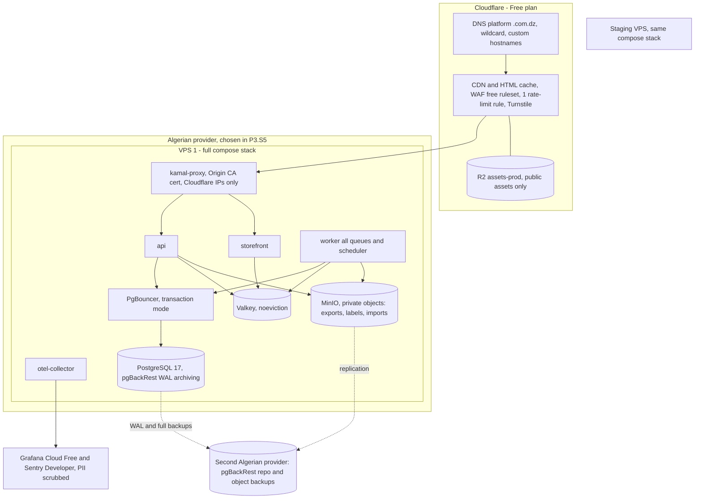
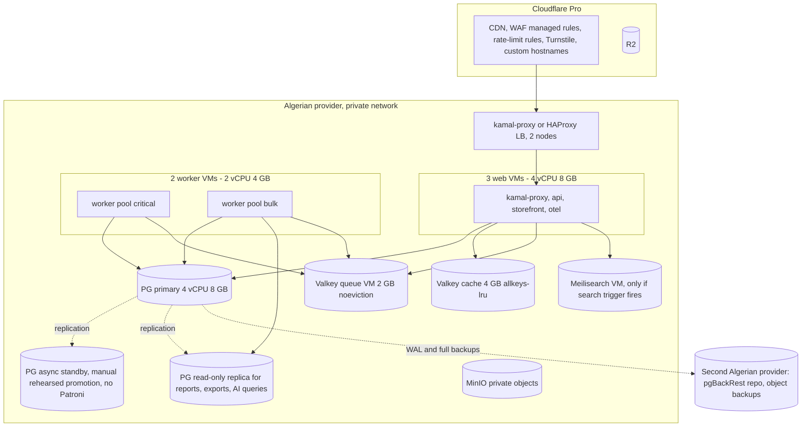
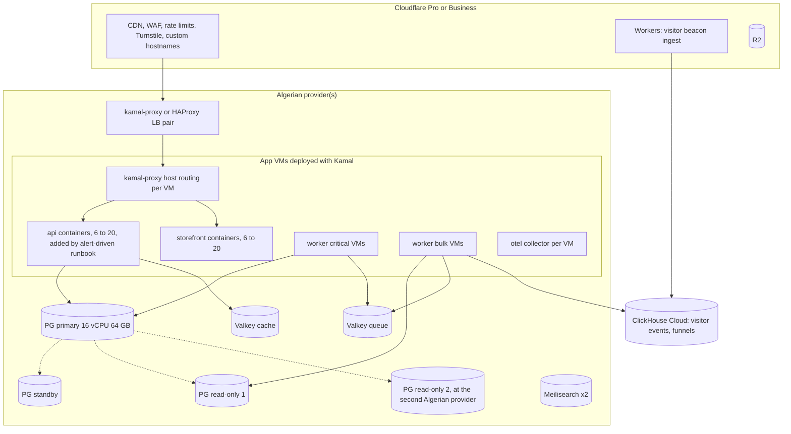

# Infrastructure

Status: proposed, 2026-11-07. **All prices are monthly, in USD, excluding VAT, estimates as of 2026-11-07. Re-verify at provisioning** (P3.S5 staging, P10.S3 production).

Source tags:
- [V] verified on an official page in `research/edge-hosting-costs.md` (EH);
- [3P] third-party figure from EH;
- [BK est] architect's estimate from background knowledge, not verified.

Decisions: ADR 0011 (hosting), 0012 (edge), 0013 (process model), 0016 (data).

> **Update 2026-11-07 (ADR 0011 accepted):** production is hosted **in Algeria** on self-run VPSs (Law 18-07 Art. 44). There is no DigitalOcean, no DOKS, no managed Postgres/Valkey and no provider API (OpenTofu covers Cloudflare/DNS only). The minimum target is **one Algerian VPS** running the full compose stack (`api`, `worker`, `storefront`, `migrate`, Postgres 17, PgBouncer, Valkey, MinIO) with pgBackRest PITR backups to a **second Algerian provider**; Growth adds a PG primary + async standby (manual, rehearsed promotion; no Patroni) and Valkey on its own VM; Scale adds VMs with Kamal (no Kubernetes). The provider is chosen in P3.S5 after a 1-month trial benchmark (CPU steal, `fsync` latency, RTT from Algerian ISPs; spike G pending before P10.S3). Private objects live in Algerian object storage (MinIO), R2 holds public assets only (ADR 0012). The topology sections below are updated; the capacity math (§3) still holds; the cost tables (§5) are the earlier EU estimates, kept for reference only, because the user set budget aside.

## 1. Topology per tier

### 1.1 Launch (≈100 stores, 5k orders/day): one Algerian VPS (minimum) + Cloudflare

**One-line Launch topology** (ADR 0011 minimum): Cloudflare (DNS, CDN/HTML cache, WAF, Turnstile, custom hostnames, R2 for public assets) → one Algerian VPS running the P0.S2b compose stack (kamal-proxy + api + storefront + worker + migrate + otel-collector from one image, plus Postgres 17, PgBouncer, Valkey and MinIO) → pgBackRest PITR backups to a second Algerian provider. A second app VPS behind kamal-proxy/HAProxy is optional at Launch (budget is not a constraint; sized in P3.S5). Plus one staging VPS; Grafana Cloud Free + Sentry Developer (EU regions, PII scrubbed per ADR 0015).

**Launch node budget** (app containers on a 2 vCPU / 4 GB node, the earlier droplet sizing). RSS figures are [BK est] for a Vendure 3.8 app with ~20 plugins and a Next 16 standalone server; P3.S5 measures them on staging and replaces this table. On the single-VPS minimum (ADR 0011) the same host also runs Postgres, PgBouncer, Valkey and MinIO, so P3.S5 sizes that VPS from the trial benchmark and adds their limits here.
| Container | Typical RSS | Hard limit (`--memory`) | Node heap flag | CPU |
|---|---|---|---|---|
| OS, Docker, journald | ~400 MB | — | — | — |
| kamal-proxy | ~30 MB | 64 MB | — | — |
| api | ~500 MB | 1,000 MB | `--max-old-space-size=768` | `--cpu-shares` 1024 (priority) |
| storefront | ~300 MB | 700 MB | `--max-old-space-size=512`, in-process LRU 64 MB | 1024 |
| worker | ~500 MB | 1,000 MB | `--max-old-space-size=768`; sharp concurrency 1; streaming xlsx; `pdf-lib` only (no headless Chromium) | `--cpus=1.0`, shares 512 (yields to api) |
| otel-collector | ~100 MB | 150 MB | `memory_limiter` processor | — |
| backup (node 2, 03:30 only) | ~50 MB | 256 MB | — | `nice` |
| **Total** | **≈ 1.9 GB steady** (≈ 2.4 GB while Kamal swaps one role) | 3.2 GB of limits | | |

A 2 GB swap file is the OOM buffer. Kamal swaps roles one at a time per host, so the transient extra is one container (≤ 1 GB). If steady memory exceeds 80 % or worker CPU starves api latency (quote p95 > 250 ms while worker CPU is saturated), the trigger in §4 moves the worker to its own VM. The design forbids headless browsers in any role at Launch for this reason.

### 1.2 Growth (≈1,000 stores, 50k orders/day)

### 1.3 Scale (≈5,000 stores, 200k orders/day): more VMs with Kamal (no Kubernetes, ADR 0011)

## 2. Load balancing details

| Hop | Algorithm / config | Health check | Notes |
|---|---|---|---|
| Cloudflare → origin | proxied DNS to LB IP; Full (strict) TLS | n/a | `Host` preserved, including custom hostnames (Cloudflare for SaaS fallback origin `fallback.ourdomain`) [EH §2] |
| origin LB (kamal-proxy/HAProxy on the VPS or an LB VM, ADR 0011/0012) → VMs | round robin, HTTP/2 to origin off, idle timeout 120 s, firewall: Cloudflare IP ranges only | `GET /api/readyz` every 10 s, 3 failures = out, 2 successes = in. The LB probe carries no store host, so kamal-proxy sends it to the **default (storefront)** route; that endpoint returns 200 only if the storefront is up **and the node-local api `/readyz` answers within 300 ms**, so it is a node-level check | Origin CA wildcard certificate; no sticky sessions |
| kamal-proxy → containers | host rules: `app.ourdomain`, `api.ourdomain`, `api.internal` → api; default → storefront | per-container check before traffic switch (api `/readyz`, storefront `/api/healthz`); drain 30 s | zero-downtime swaps per container [BK, verify default-host/wildcard behaviour in P3.S5] |
| storefront → api (internal) | local kamal-proxy with Host `api.internal` (all tiers) | — | HMAC `x-internal-sig` |
| Scale: more VMs | the same LB layer and kamal-proxy host rules on more VMs (no Kubernetes, ADR 0011) | `/readyz` per container | scaled manually from alerts (CPU, BullMQ wait-list age) |

## 3. Capacity math

**Assumptions** (README):
- peak hour = 10 % of daily orders; ad spike = 10× the peak-hour rate for ≤ 15 min;
- 30 storefront HTML views per order;
- edge HTML hit ratio 80 / 85 / 90 % per tier, and 70 % Next shared-cache hit on origin requests;
- 10 quote calls per order (8 cart + 2 shipping); 1.3 intake submits per order (holds, retries); 2 abandoned upserts per order;
- 75 visitor-track/beacon writes per order (25 sessions × (1.6 page tracks + 1.5 beacons at 60 s));
- businesses = 0.75 × stores, 1.5 concurrent dashboard users per business at peak, 0.1 rps each;
- 60 % of orders dispatched, 8 carrier status events per parcel, 6 CAPI events per order, 3 notifications per order;
- ≈ 12 KB of hot DB data per order (Vendure order + lines + history + customer + `cod_order` + timeline + parcel events, with indexes).

| Metric | Launch | Growth | Scale |
|---|---|---|---|
| Orders/day | 5,000 | 50,000 | 200,000 |
| Average orders/s | 0.06 | 0.58 | 2.3 |
| Peak-hour orders (orders/s) | 500 (0.14) | 5,000 (1.4) | 20,000 (5.6) |
| **Spike orders/s** (10×) | 1.4 | 13.9 | 55.6 |
| Intake requests at spike (rps) | 1.8 | 18 | 72 |
| **Quote calls at spike (rps)** | 14 | 139 | 556 |
| Abandoned upserts at spike (rps) | 2.8 | 28 | 111 |
| HTML views/day | 150 k | 1.5 M | 6 M |
| **HTML at edge, spike (rps)** | 42 | 417 | 1,667 |
| HTML reaching origin, spike (rps) | 8 | 63 | 167 |
| Next renders (shared-cache miss), spike (rps) | 2.5 | 19 | 50 |
| Visitor/beacon writes, spike (rps) | 104 | 1,042 | 4,167 (move to Cloudflare Worker) |
| Dashboard API at peak (rps) | 11 | 113 | 563 |
| Carrier status events/day (avg/s; burst at 10×) | 24 k (0.3; 3) | 240 k (2.8; 28) | 960 k (11; 111) |
| Polled parcels in flight (Ecotrack-type share 40 %, 4-day life) | 4.8 k | 48 k | 192 k |
| CAPI server events/day | 30 k | 300 k | 1.2 M |
| Notifications/day | 15 k | 150 k | 600 k |
| Core DB growth/year | ≈ 22 GB | ≈ 220 GB | ≈ 880 GB (archive >24 months) |
| Rolling log tables (14–30 d retention) | ≈ 4 GB | ≈ 40 GB | ≈ 160 GB |
| DB size after 12 months | ≈ 25–30 GB | ≈ 260 GB | ≈ 1 TB+ |
| Estimated API CPU at spike (quote ~8 ms, intake ~50 ms, beacon ~2 ms across both hops, dashboard ~15 ms, renders ~40 ms) | ≈ 0.6 core | ≈ 7 cores | ≈ 27 cores (≈ 19 with beacons at the edge) |
| Provisioned app vCPU (web) | 4 (shared with workers) | 12 | 56–64 |

These per-request CPU costs are **planning estimates**. P10.S2 replaces them with k6 measurements on staging: the product page → quote → submit path, plus dashboard list queries on a 5 M-order seed.

Review notes on the capacity math (arithmetic re-checked; all rows are consistent with the assumptions):
- **The edge hit ratio only holds if click-id query strings are excluded from the cache key** (system-design §2.1). Without that, ad traffic misses the edge: at the Growth spike ~417 rps of HTML would reach the origin and ~19 → ~125 rps would render, about 5 extra cores, more than the 12 web vCPU can carry next to the API. The k6 spike profile must use unique `fbclid` values per virtual user.
- **The uncached spike path is intake, not quotes**: a Vendure order creation is on the order of 100–200 SQL statements (add lines, shipping, payment, transitions, read model, outbox) [BK est, measure in spike B]. Launch spike ≈ 1.8 × 150 ≈ 270 statements/s, Growth ≈ 2,700/s, which is what sizes Postgres (1 vCPU at Launch is adequate; 4 vCPU at Growth with margin).
- **Beacons never write Postgres per request**: they go to a capped Valkey stream and are flushed every 30 s with multi-row inserts (≈ 30 inserts/min instead of 104 rps at the Launch spike).
- **A/B-tested pages bypass the edge** (no-store) and cost an origin request each; capped by plan.
- One Launch node can carry the full Launch spike (≈ 0.6 core of 2 vCPU), so losing a node does not drop orders.

**Postgres connections**: Launch 30 client connections; Growth ≈ 77 client → 40 server via PgBouncer; Scale ≈ 400 client → 100 server (ADR 0016 §6).

**Valkey memory**:
- Launch: BullMQ < 100 MB (id-only payloads, 1 h completed retention), Next remote cache budget ~300 MB (6 h TTL, ≤ 512 KB gzip entries), sessions/caches/rate limits ~100 MB, visitor stream ≤ 50 MB (MAXLEN 200 k), intake spool 0 (≤ 100 MB when used) → about 55 % of 1 GB. Redis has no per-prefix caps, so the budget is **enforced**: a worker task samples `used_memory` every 30 s and sets `{env}:cache:writes-off` above 60 %; the Next handler and our `tenantKey` cache wrapper then skip remote writes. A noeviction instance that fills up rejects BullMQ writes, so this guard protects the queue.
- Growth: queue 2 GB, cache 4 GB. Scale: queue 4 GB, cache 16 GB.

## 4. Scaling triggers (when to move up)

| Trigger (sustained 7 days unless noted) | Action |
|---|---|
| VM CPU p95 > 60 % at peak, or memory > 80 %, or quote p95 > 250 ms while worker CPU is saturated | move the worker (then Postgres, then Valkey) off the single VPS to its own VM first, then add a web VM (provisioned by runbook/Ansible + `kamal deploy`) |
| PG CPU p95 > 70 % at peak / storage > 75 % / buffer cache hit < 99 % | resize the PG VM one step at the provider (planned switchover to the standby once one exists) |
| > 50 paying stores, or any PG incident | add the PG async standby on its own VM (rehearsed manual promotion) |
| Reports/exports > 20 % of PG CPU | add a read-only replica VM; route reports, exports and AI queries there |
| Valkey memory > 60 % for 1 day (cache writes being skipped) or > 70 % at any time | split into `valkey-queue` + `valkey-cache` on their own VM(s) |
| Oldest waiting job on critical queues > 30 s at peak | dedicated worker VMs, pools via `activeQueues` |
| Search trigger (ADR 0014) | deploy Meilisearch |
| > 8 web nodes, or > 120 k orders/day | Scale tier: more VMs with Kamal, LB pair (no Kubernetes, ADR 0011) |
| PG needs > 16 vCPU/64 GB, or replica lag > 30 s p95 | dedicated server for PG at an Algerian provider; re-open ADR 0011 if no provider can host it |
| Beacon rps > 2,000 | move visitor ingest to a Cloudflare Worker → Queue → ClickHouse / batch insert |

## 5. Monthly cost per tier (USD, ex-VAT, estimates 2026-11-07)

> **Superseded (2026-11-07, ADR 0011):** the tables below are the earlier EU (DigitalOcean) estimates and no longer describe the target. Hosting is on Algerian VPSs billed in DZD, and the user set budget aside for now, so there is no Launch cost target; P3.S5 records the chosen provider's actual prices. The ADR 0011 Evidence has a rough Algerian Launch sketch. The observability volume budget and the pass-through notes below still apply.

### 5.1 Launch (EU estimate, superseded)
| Line item | Spec | $/mo | Source |
|---|---|---|---|
| Production compute | 2 × DO Basic droplet 2 vCPU/4 GB | 48 | [V] EH §4 |
| Load balancer | DO LB, 1 node | 12 | [V] EH §4 |
| PostgreSQL | DO Managed PG 17, 1 vCPU/2 GB, single node, daily backups + PITR | ~30 | [BK est]; entry plan $15.15 [V] |
| Valkey | DO Managed Valkey 1 GB | 15 | [V] EH §4 |
| Staging | 1 × droplet 2 vCPU/4 GB (all roles + PG/Valkey containers) | 24 | [V] |
| Cloudflare | Free plan; ≤ 100 custom hostnames included; Turnstile | 0 | [V] EH §2–3; Turnstile limits [?] |
| R2 | media ~20 GB + backups growing to ~100–160 GB by month 12 (14 daily + 3 monthly age-encrypted dumps of a ≤ 30 GB DB, ~6–8 GB each); image reads mostly edge-cached, so Class B stays inside the free 10 M/month | ~1–3 | [V] EH §6 pricing; volumes [BK est] |
| Email | Amazon SES ~15 k/mo at $0.10/1k. Assumes per-order notifications default to Web Push/in-app and per-order email is opt-in; if every merchant opts in, ≈ 450 k/mo ≈ $45 | ~2 | [3P] EH §7 |
| Observability | Grafana Cloud Free, Sentry Developer, Cloudflare Web Analytics, inside the volume budget below | 0 | [3P] EH §9 |
| CI / registry | GitHub Actions (private-repo minutes within plan), GHCR | 0–5 | [BK est] |
| Domain | `.com` ≈ $12/yr | ~1 | [BK est] |
| **Total** | | **≈ $133–140** | |
| Optional: Launch-HA | PG standby node | +~30 (≈ $165–170) | [BK est] |
| Optional: worker droplet | when the §4 trigger fires | +24 | [V] |

**Observability volume budget at Launch** (Grafana Cloud Free: ~10 k series, 50 GB logs, 50 GB traces per month [3P EH §9]; all [BK est]):
- Requests + jobs ≈ 0.7 M/day (quotes ~50 k, beacons ~375 k, HTML origin ~30 k, dashboard ~40 k, webhooks ~24 k, jobs ~150 k).
- Traces unsampled ≈ 15 spans × 0.4 KB × 0.7 M ≈ 4 GB/day ≈ 125 GB/month, **over** the free tier. Policy: beacon and track requests are never traced; tail sampling keeps errors and > 1 s traces plus 10 % of the rest → ≈ 10–15 GB/month.
- Logs: one line per request/job, beacons aggregated per minute → ≈ 0.4 M lines × 0.5 KB ≈ 6 GB/month.
- Series: per-route histograms with the label allow-list (ADR 0015) ≈ 3–5 k.
- Sentry Developer: 5 k errors/month and 1 user. One bad deploy can burn the quota in minutes; SDK-side rate limiting and Sentry spike protection on, and errors are also in logs. Move to Team ($26) with the second engineer or the first paying merchants, whichever comes first.
- At Growth (×10 traffic) keep the same policy at 2–5 % sampling; the ~$80 Grafana line assumes that.

Pass-through costs billed to merchants, not infrastructure: WhatsApp messages (≈ $0.004–0.027/msg [3P EH §7]), SMS ($0.273/segment to DZ [V EH §7]; Arabic text is UCS-2, 70 characters per segment, so a typical Arabic message is 2–3 segments ≈ $0.55–0.80), Claude API tokens (via AI credits), payment fees (Chargily 0 % for the first 300 tx then 1.5–4.5 % [V EH §8]). **They are only pass-through if metered and prepaid**: WhatsApp/SMS use a per-business prepaid message balance and stop at zero; LLM usage is reserved and committed per call (system-design §4). Unmetered, WhatsApp alone could reach ≈ $7 k/month at Growth (50 k orders/day × 1 utility message × $0.0048 × 30).

### 5.2 Growth (EU estimate, superseded): ≈ $970/month
| Line item | Spec | $/mo | Source |
|---|---|---|---|
| Web compute | 3 × DO 4 vCPU/8 GB | 144 | [V] |
| Worker compute | 2 × DO 2 vCPU/4 GB | 48 | [V] |
| Load balancer | DO LB, 2 nodes | 24 | [V] ($12/node) |
| PG primary | 4 vCPU/8 GB | ~120 | [BK est] |
| PG standby | same size | ~120 | [BK est] |
| PG read-only node | same size | ~120 | [BK est] |
| PG extra storage | ~250 GB | ~50 | [BK est] |
| Valkey queue | 2 GB | ~30 | [BK est] (extrapolated from $15/1 GB [V]) |
| Valkey cache | 4 GB | ~60 | [BK est] |
| Meilisearch (only if triggered) | 1 × droplet 2 vCPU/4 GB | 24 | [V] |
| Staging | 2 × 2 vCPU/4 GB | 48 | [V] |
| Cloudflare Pro | monthly billing | 25 | [V] EH §3 |
| Cloudflare for SaaS | 250 custom hostnames → 150 billable × $0.10 | 15 | [V] EH §2 |
| R2 | ~400 GB media + ~400 GB weekly/monthly dumps + operations | ~17 | [V] EH §6 pricing; volumes [BK est] |
| Grafana Cloud | Pro $19 + usage (2–5 % trace sampling) | ~80 | [3P] EH §9, usage [BK est] |
| Sentry | Team | 26 | [3P] EH §9 |
| Email | SES ~150 k/mo (per-order email opt-in) | ~15 | [3P] |
| **Total** | | **≈ $966** (range $850–1,150) | |

### 5.3 Scale (EU estimate, superseded): ≈ $5,000–8,000/month
| Line item | Spec | $/mo | Source |
|---|---|---|---|
| DOKS control plane (HA) | | ~40 | [BK est] |
| K8s nodes | 12 × 8 vCPU/16 GB (8 web, 4 worker) | 1,152 | [V] ($96 each) |
| Load balancer | 3–4 nodes | ~48 | [V] |
| PostgreSQL | 16 vCPU/64 GB primary + standby + 2 read-only nodes | 2,000–4,000 | [BK est, wide] |
| PG storage | ~1.2 TB | ~250 | [BK est] |
| Valkey | queue 4 GB + cache 16 GB | ~300 | [BK est] |
| ClickHouse Cloud | 24/7, scaled from the basic tier | 190–600 | [3P] EH §11 |
| Meilisearch | 2 × 4 vCPU/8 GB | 96 | [V] |
| Cloudflare | Business (monthly) or Pro + add-ons | 25–250 | [V] |
| Cloudflare for SaaS | 1,250 custom hostnames → 1,150 × $0.10 | 115 | [V] |
| Cloudflare Workers | beacon ingest, paid plan + usage | ~150 | [BK est] |
| R2 | ~3 TB + operations | ~65 | [V] |
| Observability | Grafana Cloud + Sentry Business | ~400 | [BK est] |
| Staging / perf environment | | ~150 | [BK est] |
| Email | | ~60 | [3P] |
| **Total** | | **≈ $5,000–8,000** | |

Sanity check (assumption): at Scale, ≈ 3,750 businesses on a 1,900–9,900 DZD/month plan mix [DM "Billing"] gives MRR roughly two orders of magnitude above the infrastructure bill. At Growth, infrastructure is about 3–5 % of MRR. This is only a rough check; it ignores payment fees and FX.

## 6. Migration path

**Launch → Growth** (trigger table §4; each step is independent and reversible):
1. Move Postgres off the single VPS to its own VM and add the async standby (pgBackRest restore + streaming replication; scripted, rehearsed manual promotion; no app change, ADR 0011).
2. Resize the PG VM to 4 vCPU/8 GB (planned switchover off-peak).
3. Split Valkey: create `valkey-cache`, set `REDIS_CACHE_URL` (Vendure cache, Next handler, rate limits, host map) and keep `REDIS_QUEUE_URL` on the old instance (switch eviction policies accordingly). Deploy. Old cache keys expire.
4. Dedicated worker VMs: Kamal role `worker` with `ACTIVE_QUEUES=critical|bulk` env per host group.
5. Read-only node: add `DATABASE_REPLICA_URL` and route report/export/AI repositories to it.
6. Cloudflare Pro: add rate-limit rules (quotes, login, webhooks) and managed WAF rules.
7. Meilisearch if the ADR 0014 trigger fires (index backfill from Postgres, then a flag flip `search.meili.enabled`).

**Growth → Scale**:
1. More app and worker VMs (provisioned by runbook/Ansible; no provider API) deployed with Kamal from the same image, env and `/readyz`/`/livez` checks, behind an LB pair. No Kubernetes (ADR 0011: no managed offer in Algeria, self-run K8s out of scope).
2. New VMs join behind the LB by host group; shift traffic by changing the Cloudflare origin for a canary set of store hosts if the LB layer changes. Roll back by switching the origin back.
3. Visitor ingest moves to a Cloudflare Worker → Cloudflare Queue → batch insert / ClickHouse. ClickHouse takes visitor events and funnels; Postgres rollups remain for KPIs.
4. Data tier: a dedicated PG server at an Algerian provider, moved by logical replication with a read-only cutover window of about 15 min.

**EU fallback** (ADR 0011 Decision 9): only if the ANPDP authorises transfers to the EU or the law changes; only `infra/` and the deploy config change.
