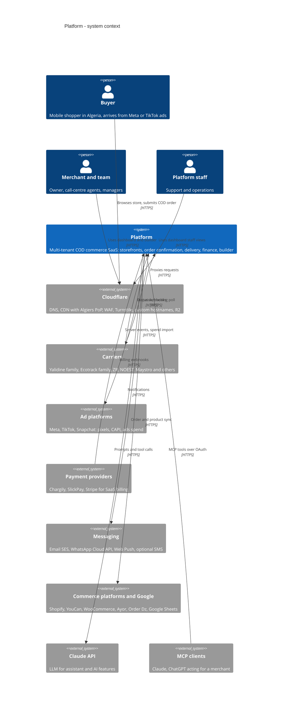
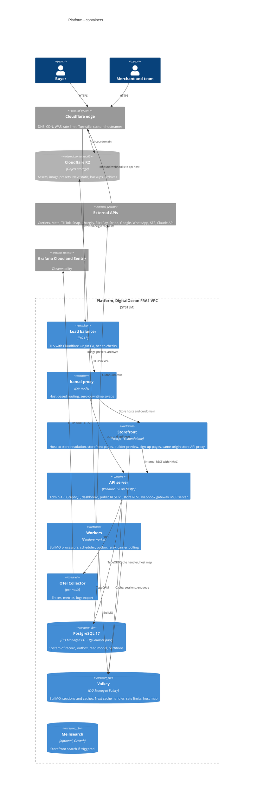
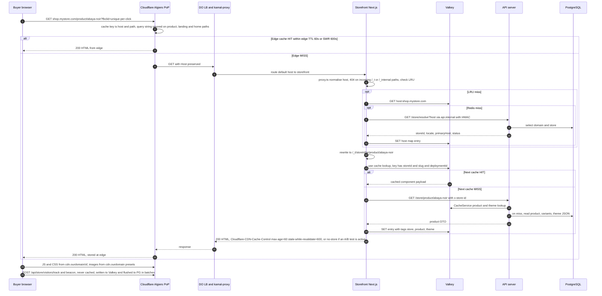
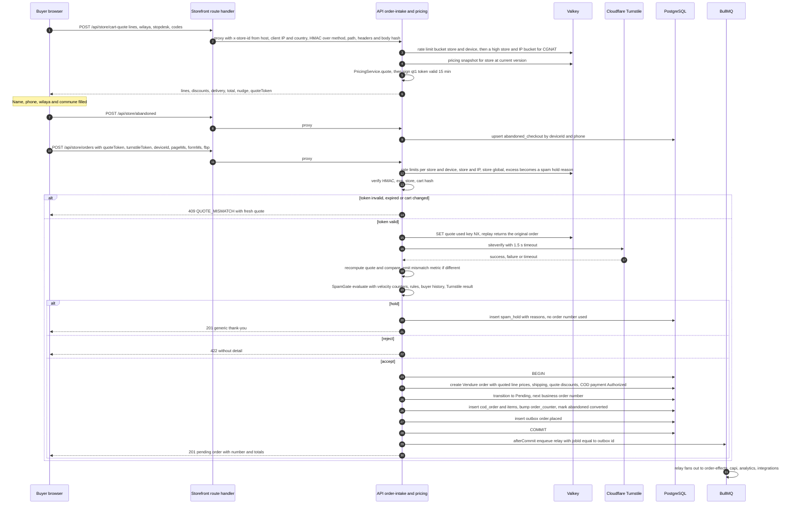
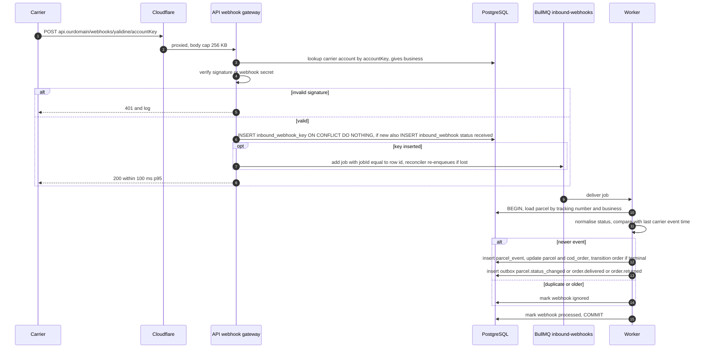
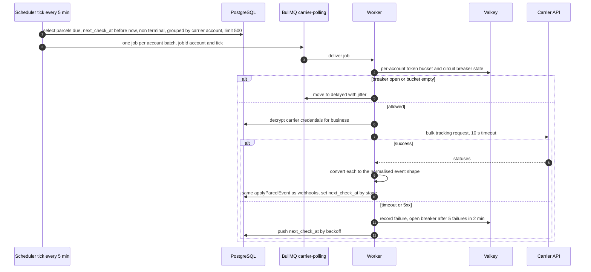
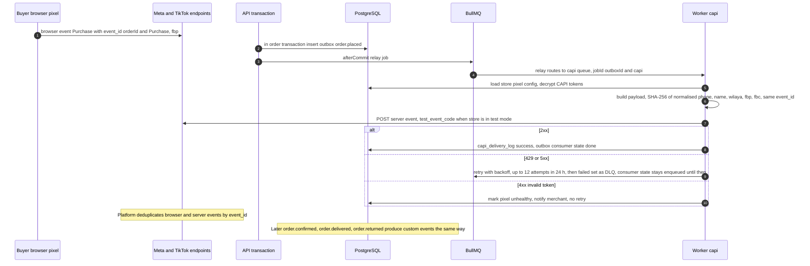
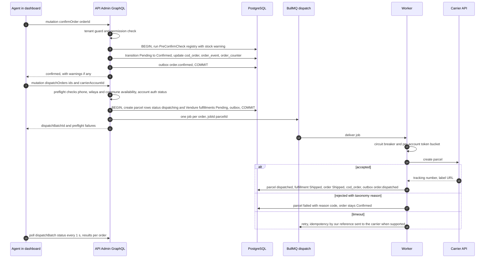
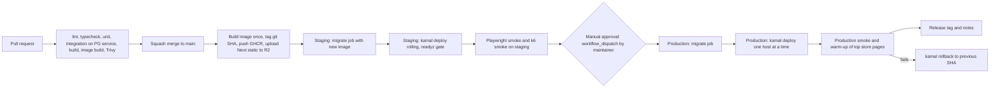

# System design

Status: proposed architecture, 2026-11-07. Decisions are recorded in `docs/adr/drafts/` (ADR-xxxx). Citation keys: [VN §n] = `research/vendure-v3.md`, [EH §n] = `research/edge-hosting-costs.md`, [DM] = `../research/data-model.md`, [BK] = background knowledge to verify. Product name and root domain are placeholders ("Platform", `ourdomain`). The reference product's names, logos and theme names are never used (ADR 0007).

Contents: 1 Component view · 2 Request flows · 3 Load balancing & edge · 4 Scaling · 5 Data · 6 Integrations · 7 Security · 8 Observability · 9 Environments & delivery · 10 Reliability

---

## 1. Component view

### 1.1 System context (C4 level 1)

### 1.2 Containers (C4 level 2)

### 1.3 Container responsibilities

| Container | Responsibilities | Stateless? | ADR |
|---|---|---|---|
| Cloudflare edge | DNS for `ourdomain`, proxy for all hosts, HTML cache for store hosts, WAF, 1 edge rate-limit rule (Free), Turnstile, custom hostnames (Cloudflare for SaaS), R2 custom domain `cdn.ourdomain` | n/a | 0012 |
| Load balancer | TLS (Origin CA), node-level health check `/api/readyz` every 10 s (infrastructure §2), accepts Cloudflare IPs only | yes | 0012 |
| kamal-proxy | Per-node L7 router by Host: `app.`/`api.`/`api.internal` → api, default → storefront. Zero-downtime container swap | yes | 0013 |
| Storefront (`ROLE=storefront`) | `proxy.ts` host→store, buyer-agnostic cached pages, preview, marketing + sign-up/reset pages, same-origin `/api/store/*` proxy, internal revalidate endpoint | yes | 0006 |
| API (`ROLE=api`) | Vendure Admin API + DashboardPlugin (`app.ourdomain`), our plugins' GraphQL/REST, store REST (internal only), public REST v1 + webhooks gateway + MCP + OAuth (`api.ourdomain`), readiness. **The Vendure Shop API, `/store/*` and `/_internal/*` are internal-only on every host** (`InternalOnlyGuard`, §7) | yes | 0008, 0010, 0013 |
| Worker (`ROLE=worker`) | BullMQ processors by pool, scheduler tasks, outbox relay + sweeper, **job reconciler** (re-enqueues durable job rows after Valkey loss), carrier polling, CAPI, notifications, integrations, AI jobs, image presets, documents (PDF labels, xlsx exports), catalog feeds, visitor-event flush | yes | 0013, 0016 |
| PostgreSQL 17 | Vendure core schema + plugin tables, `cod_order` read model, outbox, partitions, rollups. PITR | no | 0016 |
| Valkey | BullMQ (noeviction), Vendure CacheService/sessions, Next cache handler, rate-limit buckets, host map, pub/sub invalidation, live-visitor counters, visitor-event buffer (capped stream). **Not a system of record**: every job whose loss matters has a durable Postgres row (ADR 0013 "Job durability") | rebuildable | 0013 |
| R2 | `assets-prod` (public via `cdn.ourdomain`): media originals + presets (`b/{businessId}/s/{storeId}/...`), `sf/_next/static/*`, catalog feeds. `private-prod` (never public; an R2 custom domain exposes a whole bucket, so private data cannot share it): exports, documents, uploads, `backups/`, `archive/` (Parquet) | n/a | 0006, 0016 |
| Meilisearch (optional) | Storefront search index per environment, `storeId` filter + tenant tokens | rebuildable | 0014 |
| OTel Collector | Tail sampling, attribute scrubbing, export to Grafana Cloud | yes | 0015 |

---

## 2. Request flows

### 2.1 Storefront page view (edge hit / origin miss)

Notes on 2.1 (review fixes):
- **Ad click ids make every landing URL unique** (`fbclid`, `ttclid`, `gclid`, `sc_click_id`, `utm_*`). With the default Cloudflare cache key (which includes the query string) the edge hit ratio for ad traffic would be close to 0 and the whole 10× spike would reach the origin. The Cache Rule therefore ignores the query string on product, landing and home paths, and those pages never read `searchParams` on the server. The pixel reads click ids client-side from `location` and the COD form sends them with the intake (attribution, spam "ad-click velocity"). Listing and search pages keep `page`, `sort` and `q` in the key. Plan availability of the cache-key option is [BK, verify in spike F]; fallbacks are a Page Rule "ignore query string" or a Cloudflare Worker that normalises the URL ($5/month plan).
- **A/B tests** (feature-inventory §7) cannot be split by an edge cache keyed on (host, path). While a test is active on a page, its origin response carries `Cloudflare-CDN-Cache-Control: no-store`. `proxy.ts` assigns a sticky variant cookie (`ab_{testId}`) by the configured split and rewrites to `/_t/[storeId]/[locale]/v/[variant]/...`, so each variant is still cached in the Next shared cache. Variant exposure is sent with the visitor track and the intake. Cost: tested pages always reach the origin (cheap Next cache hits); concurrent tests per store are plan-limited.

### 2.2 Cart quote → order intake (signed quote, spam check, abandoned checkout)

Degraded mode (Launch, single PG node): if the `BEGIN` fails because Postgres is unreachable, and the flag `intake.spool.enabled` is on, the API writes the already-verified submit (quote token, form, signals) to the Valkey stream `{env}:intake:spool` (noeviction, capped at 50 k entries) and answers `202` "received, confirmation follows". A worker replays the spool through the same intake service once `/readyz` is green; the unique `cod_order.quote_hash` makes replays idempotent. This turns a PG outage into delayed orders instead of lost ad-driven orders. If Valkey is also down, the API answers `503` and the form keeps the data for a client retry.

### 2.3 Carrier webhook ingestion

### 2.4 Carrier polling job

### 2.5 CAPI server events via the outbox

### 2.6 Dashboard confirm → dispatch

---

## 3. Load balancing & edge

**Host routing** (ADR 0012):
| Host / path | Edge behaviour | Origin target |
|---|---|---|
| `*.ourdomain`, custom hostnames, `ourdomain`, `www` | Cache Rule eligible (store hosts), cache key ignores the query string on product/landing/home paths, edge TTL from `Cloudflare-CDN-Cache-Control`, abuse-level rate-limit rule on order/abandoned paths. **No Bot Fight Mode** (zone-wide on Free, cannot be skipped per path [BK, verify]) | storefront |
| `<store host>/api/store/*` | bypass cache. Same-origin. Turnstile on submit | storefront route handler → api (internal) |
| `<store host>/__preview*` | bypass | storefront |
| **any host** `/_t/*`, `/_internal/*`, `/store/*`, `/shop-api*` | **blocked** (403, one WAF custom rule over all hosts) | — |
| `app.ourdomain` | cache hashed assets only | api (DashboardPlugin + `/admin-api`) |
| `api.ourdomain/api/v1/*`, `/webhooks/*`, `/mcp`, `/oauth/*` | bypass cache. WAF. Body caps | api |
| `cdn.ourdomain` | R2 custom domain, long TTL (immutable hashed keys) | R2 |

The edge block is defence in depth only. `app.ourdomain` and `api.ourdomain` both reach the same api container, and the LB accepts any `Host` that arrives through Cloudflare (including from other Cloudflare zones pointing at our LB IP), so the **api role itself** rejects the Shop API, `/store/*` and `/_internal/*` unless the request carries a valid internal HMAC (`InternalOnlyGuard`, §7). The `api.internal` kamal-proxy route has no meaning outside the node and is protected by the same HMAC.

**LB and proxy settings**:
- DO LB: round robin, node-level health check `GET /api/readyz` every 10 s (no store host, so kamal-proxy's default route sends it to the storefront, which also checks the node-local api `/readyz`), unhealthy after 3 failures. One node carries the Launch spike, so removing a node whose api is broken is safe. Idle timeout 120 s (SSE for the AI assistant sends a heartbeat every 15 s; Cloudflare's proxied origin-response limit is about 100 s [BK]).
- kamal-proxy: `response_timeout` 30 s (api) / 15 s (storefront), body limit 10 MB (imports go to R2 by presigned upload), buffering disabled on SSE routes.

**No sticky sessions**: sessions are in Redis/PG, the Next cache is in Redis, the quote token is self-contained, and the device id lives in the browser.

**Client IP**: the API trusts `CF-Connecting-IP` only when the request comes from the LB (`trustProxy` set [VN §1]). The storefront proxy forwards it as `x-client-ip`, and `CF-IPCountry` as `x-client-country` (spam rule "network abroad"), both covered by its HMAC.

**CGNAT**: Algerian mobile operators put many subscribers behind shared IPv4 addresses [BK, verify with RUM]. Per-IP limits are therefore abuse-level only (edge: about 30 requests per 10 s per IP on order/abandoned paths; Free plan rules count over a 10 s period [BK]). Buyer-level throttling uses the device id, and exceeding an IP bucket turns an intake into a **spam hold**, never a 429, so a whole carrier NAT pool is not locked out during an ad spike.

---

## 4. Scaling per component

| Component | Scale unit | Primary signal (scale out) | Secondary | Launch → Growth → Scale |
|---|---|---|---|---|
| Storefront | container | CPU > 60 % 5 min, p95 render > 400 ms | Next cache hit < 70 % | 2 → 3 → 6–20 (HPA) |
| API | container | CPU > 60 %, event-loop lag p95 > 100 ms | DB pool waiting > 0 for 1 min | 2 → 3 → 6–20 (HPA) |
| Worker critical | container | oldest waiting job age > 30 s (critical queues) | active = concurrency for 5 min | 2 (shared) → 2 → KEDA 2–10 |
| Worker bulk | container | oldest waiting > 10 min (capi, integrations, polling) | DLQ growth | shared → 2 → KEDA 2–20 |
| PostgreSQL | vertical + read-only node | CPU > 70 % p95 1 h, storage > 75 % | cache hit < 99 %, replica lag | 1 vCPU/2 GB → 4/8 + standby + RO → 8–16/32–64 + standby + RO ×2 |
| Valkey | vertical, then split | memory > 70 % | ops latency p99 > 5 ms | 1 GB → queue 2 GB + cache 4 GB → 4 GB + 16 GB |
| Cloudflare | plan | WAF/rate-rule needs | — | Free → Pro → Pro/Business |

At Launch/Growth scaling is **manual from alerts**: add a droplet in OpenTofu and run `kamal deploy`, about 10 min. Autoscaling (HPA on CPU, KEDA on BullMQ wait-list length) arrives with DOKS at Scale.

**Ad-spike playbook** (10× for minutes): edge cache absorbs page views (60 s TTL, SWR 600 s) **only because click-id query strings are excluded from the cache key** (§2.1 notes). Quotes are cache-only and CPU-bound on the API. Intake is the uncached path: about 1.8 / 18 / 72 rps of Vendure order-creation transactions at the Launch / Growth / Scale spike, which is the real Postgres load of a spike. Pre-warming is not needed. The capacity math in `infrastructure.md` sizes the API for the spike at about 50 % CPU headroom. If a merchant's ad points to an A/B-tested page, that page's views reach the origin (Next cache hits).

**Noisy neighbours and per-tenant limits**:
| Layer | Limit (default; plan-configurable) | Enforcement |
|---|---|---|
| Edge | ~30 req/10 s per IP on order + abandoned paths (abuse only, CGNAT-safe) | Cloudflare rate-limit rule |
| Storefront public API | quotes 60/min per (store, device) and 600/min per (store, IP); intake 5/min per (store, device), 60/min per (store, IP), **300/min per store**. Above any intake limit: hold for review, never drop | Valkey token buckets (Lua), fail-open with a spam flag if Valkey is down |
| Admin API | 20 rps sustained / burst 100 per business; GraphQL complexity cap via `HardenPlugin` [VN §1] | guard + plugin |
| Public API v1 | 10 rps per key (plan-based), 429 + `Retry-After` | guard |
| Exports, imports, platform sync, AI | 1–2 concurrent jobs per business (semaphore) | ADR 0013 |
| DB | `statement_timeout` api 5 s, worker 60 s, replica reporting 30 s; exports on replica (Growth) | role settings |
| Storage | media quota per plan (e.g. 2/10/25 GB) | upload guard |
| LLM | credits (P9.S2): reserve before the call, commit **actual** token usage on completion **or client abort**, refund only on provider error; `max_tokens` per feature; per-business daily token ceiling; per-business concurrency 2; platform monthly spend alert at 80 % of budget | `withCredits` |
| WhatsApp / SMS (paid per message) | per-business prepaid message balance; sending stops at zero (fallback: in-app + email) | notifications guard |
| A/B tests | concurrent active tests per store (plan) | builder |

---

## 5. Data

**PostgreSQL 17** (DO Managed). Pinned major version; 18 is evaluated at Growth once Vendure's CI lists it [VN §9: supported PG versions not documented]. UTC [VN §9].
- Extensions: `pg_trgm`, `btree_gin`, `unaccent`, `pg_stat_statements` (availability on DO to verify in P3.S5).
- Settings: `idle_in_transaction_session_timeout=30s`, role-specific `statement_timeout`, `log_min_duration_statement=500ms`.

**Pooling** (ADR 0016 §6):
- DO managed PgBouncer pool. Transaction mode only after spike D passes, otherwise session mode.
- Client pools: api 10, worker 5 per process.
- Connection math: Launch 2×10 + 2×5 = 30 clients; Growth 3×15 + 4×8 = 77 clients → 40 server connections; Scale ≈ 400 clients → 100 server connections.
- The migrate job connects directly.

**Read replica** (Growth): a DO read-only node serves analytics reports, exports, the AI order Q&A and the read-model consistency check. Routing goes through Vendure replication mode or a second DataSource [VN §9, API UNVERIFIED]. Reads that need read-your-writes stay on the primary.

**Schema ownership**:
- Vendure core tables are untouched except custom fields (Order: `businessId`, `storeId`, `orderNumber`, `quoteDiscounts`, `quotedShipping`; OrderLine: `quotedUnitPrice`, `originalPrice`, `discounts`).
- Plugin tables extend `TenantEntity` (ADR 0002). IDs follow ADR 0003.

**Read model** `cod_order` + `cod_order_item` + `order_counter`: written in the same transaction as every order change (ADR 0009). Indexes are in ADR 0016 §4.

**Partitioning, archival and retention**: ADR 0016 §3 (orders timeline, parcel events, stock movements, visitor events, CAPI/webhook logs, outbox, audit, notifications).

**Migrations**: TypeORM generated, reviewed, expand/contract, `CONCURRENTLY` indexes non-transactional, `migrate` release job before rollout (ADR 0016 §5).

**Redis/Valkey roles and key design** (all keys prefixed `{env}:`; tenant keys include `b:{businessId}` or `s:{storeId}`):
| Role | Keys | TTL | Launch instance | Growth instance |
|---|---|---|---|---|
| BullMQ | `bull:{env}:{queue}:*` | job retention | single (noeviction) | `valkey-queue` (noeviction, AOF) |
| Vendure sessions + CacheService | `vendure:*` | session / cache TTL | single | `valkey-cache` (allkeys-lru) |
| Next cache handler | `next:{deploymentId}:*`, tag manifest; gzip entries; **remote writes skipped while `{env}:cache:writes-off` is set** (a worker task sets it when `used_memory` > 60 % at Launch, so the cache can never push the noeviction instance into OOM and fail BullMQ writes) | ≤ 6 h at Launch, ≤ 24 h at Growth | single | `valkey-cache` |
| Visitor buffer | `{env}:visitors` stream (`XADD MAXLEN ~200000`), drained every 30 s by `visitor-flush` into `visitor_event` with multi-row inserts | until drained | single | `valkey-cache` (loss of ≤ 30 s of visitor events is accepted) |
| Intake spool (degraded mode) | `{env}:intake:spool` stream, capped 50 k | until replayed | single | `valkey-queue` |
| Pricing snapshot | `pricing:s:{storeId}:v{n}` | 24 h + version bump | single | `valkey-cache` |
| Host map | `host:{host}` | none (explicit invalidation) + 7 d safety | single | `valkey-cache` |
| Rate limits | `rl:{scope}:{key}` | window | single | `valkey-cache` |
| Quote replay | `quote:used:{hash}` | 1 h | single | `valkey-queue` (must not be evicted) |
| Spam velocity | `vel:s:{storeId}:dev:{deviceId}:24h` etc. (sorted sets / HLL) | window | single | `valkey-cache` |
| Live visitors | `live:s:{storeId}` (ZSET by last seen) | 2 min | single | `valkey-cache` |
| Semaphores / locks | `sem:{queue}:b:{businessId}`, `lock:*` | job TTL | single | `valkey-queue` |
| Invalidation pub/sub | channel `{env}:invalidate` | — | single | `valkey-cache` |

**Outbox and inbound gateway**: ADR 0016 §1–2. Durable intent always lives in Postgres, Redis only accelerates.

**Search**: Postgres normalised `search_text` + `pg_trgm` at Launch. Meilisearch on triggers (ADR 0014).

**Analytics**: rollup tables first, then the read replica (Growth), then ClickHouse for visitor/funnel data (Scale) (ADR 0016 §7).

**Object storage layout** (two R2 buckets: `assets-prod` public through the `cdn.ourdomain` custom domain, and `private-prod` never public): `assets-prod/b/{businessId}/s/{storeId}/assets/{assetId}/{orig|w160|w320|w640|w960|w1280}.webp`, `assets-prod/sf/_next/static/...`, `assets-prod/feeds/{storeId}/{feedToken}.{xml|csv}` (catalog feeds, regenerated on `product.changed`, debounced 10 min), `private-prod/exports/b/{businessId}/...` and `private-prod/documents/b/{businessId}/...` (labels PDF, presigned GET, **1 h**, re-issued from the dashboard), `private-prod/uploads/b/{businessId}/...` (presigned PUT for imports, receipts and media originals before derivation), `private-prod/backups/pg/{date}.dump.age`, `private-prod/archive/{table}/{yyyy-mm}.parquet`. Only product/theme media is public; merchant documents (receipts, labels, exports, imports) never go to the public bucket. Vendure's `AssetServerPlugin` route is not exposed for on-the-fly transforms; presets come from the `asset-derivatives` job (ADR 0006).

**Backups**:
- DO managed daily backups + PITR within 7 days [BK, verify window].
- Launch: a nightly logical `pg_dump -Fc` (Kamal accessory `backup`: a cron container with `pg_dump`, `age` and an S3 client, on node 2 at 03:30 Africa/Algiers) to R2 (different provider), encrypted with age (private key offline, held by two people). Retention **14 daily + 3 monthly** (≤ 90 days), via an R2 lifecycle rule, with an R2 bucket lock on `backups/` [BK, verify].
- Growth: the nightly dump stops being practical above ~100 GB. Switch to a **weekly** dump taken from the read-only node (4 weekly + 3 monthly) and rely on DO PITR for the 7-day window.
- **R2 has no S3 object versioning** [BK, verify]. Accidental asset deletion is covered by soft delete instead: deleted assets move to `trash/` with a 30-day lifecycle rule.
- **Erasure ledger**: business-deletion and buyer-erasure requests are recorded in `erasure_log` (ids only). After any restore, the ledger is replayed before traffic is allowed, so a restore never resurrects erased PII. PII in backups therefore disappears within 90 days of a request (statement for the privacy policy).
- Secrets needed for a restore (age key, KEK for `tenant_secret`, quote HMAC keys) are escrowed offline. Losing the KEK means every merchant re-enters carrier and CAPI credentials.

---

## 6. Integrations

All outbound calls run in workers (never on request paths, except the bounded synchronous Turnstile check and the dispatch preflight reads). Each adapter has timeouts, a circuit breaker per (provider, account), retries with jitter and contract tests against recorded fixtures (P5 pattern).

| Integration | Direction / mechanism | Auth & secrets | Limits & failure handling | Queue | Session |
|---|---|---|---|---|---|
| Yalidine family | dispatch (REST), **webhooks** for status, price sync | API id/token + webhook secret per account (encrypted) | per-account bucket (carrier limits unknown [?], default 5 rps), breaker | dispatch, inbound-webhooks | P5.S4 |
| Ecotrack family | dispatch, **polling** (bulk where supported), price sync | token + base URL per account | per-account bucket, stage-based `next_check_at` | dispatch, carrier-polling | P5.S5 |
| ZR, NOEST, Maystro, Elogistia, Ecom Delivery, Zimou, Osen | per carrier API (webhook where offered, else polling) | per account | same adapter contract | dispatch, inbound-webhooks / carrier-polling | P5.S6–S7 |
| Meta / TikTok / Snapchat CAPI | outbox → server events, dedup `event_id` | per-store tokens (encrypted); test mode | 12 retries over 24 h, then DLQ; invalid token → unhealthy + notify | capi | P9.S3 |
| Meta / TikTok Ads | OAuth; daily spend import + on-demand refresh | refresh tokens (encrypted) | API rate limits → backoff; per-business semaphore | integrations | P9.S4 |
| Google Sheets | OAuth; append rows batched (≤ 1 write/s per sheet), import orders | refresh token | Sheets per-minute quotas [BK] → batch + backoff | integrations | P9.S5 |
| WhatsApp Cloud API | utility templates (confirmation), status webhooks | system user token per business or platform BSP [?] | per-message cost passed to merchant [EH §7] through a **prepaid per-business message balance** (if the platform's WABA pays Meta, an unmetered Growth month could cost ≈ 50 k orders × 30 d × $0.0048 ≈ $7 k); webhook via gateway | notifications, inbound-webhooks | P9.S5 |
| Shopify / YouCan / WooCommerce / Ayor / Order Dz | webhooks in (gateway) + scheduled sync | OAuth / API keys (encrypted) | per-business semaphore, idempotent upserts by external id | integrations, inbound-webhooks | P9.S6 |
| Chargily / SlickPay / Stripe (SaaS billing) | checkout redirect + webhooks | platform keys (env secrets) | webhook idempotency via gateway; provider down → grace period extended, intake never blocked | inbound-webhooks | P9.S2 |
| Email (SES eu-west-3) | transactional (verification, invitations, notifications) | platform IAM key | SES sending quotas; bounce/complaint via SNS → gateway | notifications | P1.S2, P7.S3 |
| Web Push | VAPID | platform keys | expired subscriptions pruned | notifications | P7.S3 |
| SMS (opt-in add-on) | local aggregator or Twilio ($0.273/segment to DZ [EH §7]) | platform | paid add-on only | notifications | later |
| Claude API | `LlmClient` (P9.S7a), tool use, streaming for the assistant (SSE) | platform API key | per-business concurrency, credits committed on success, 60 s timeout, model ids pinned in config | ai (async) or request-path SSE (assistant) | P9.S7a/b |
| MCP clients | Streamable HTTP MCP endpoint `api.ourdomain/mcp`, OAuth 2.1 (ADR 0008) | per-grant tokens | per-grant rate limit; tools reuse API v1 services and scopes | — | P9.S8b |
| Outbound merchant webhooks | outbox → signed POST | per-subscription secret | 12 retries over 24 h, delivery log + replay | outbound-webhooks | P9.S8a |
| Cloudflare API | custom hostnames, purge by host | scoped API token (env) | retries; purges **coalesced per store** (one purge per store per 30 s window, because purge API calls are rate-limited per plan [BK]); cache TTL bounds staleness | domains, storefront-revalidate | P8.S9 |
| Carrier labels and documents | carrier label PDFs fetched by the worker (some label URLs need the account token), bulk "Print labels" merged into one PDF with `pdf-lib`; private-courier labels and delivery sheets rendered by our template with `pdf-lib` (no headless Chromium: it does not fit the Launch memory budget) | per-account credentials | 200 labels per job, stored in `private-prod/documents`, presigned 1 h | `documents` (bulk) | P5.S1, P5.S2 |
| Exports (xlsx/csv) | streaming writer (row-by-row, constant memory); synchronous below 500 rows, otherwise a job | — | per-business semaphore 1 | `imports-exports` | P4.S2, P5.S2, P6.* |
| Catalog feeds (Meta/TikTok/Snap/Google) | generated to `assets-prod/feeds/` on `product.changed` (debounced 10 min), served from the CDN under an unguessable token | — | — | `integrations` | P9.S3 |

Real-time in the dashboard (notification bell, new-order badge, live visitors snapshot, dispatch batch progress) is **polling** at Launch/Growth (10–30 s; 1 s only for an open dispatch batch), already inside the 0.1 rps per user planning figure, plus Web Push for out-of-tab alerts. SSE is used only for the AI assistant stream. No WebSocket tier.

LLM data handling: prompts contain business data. Buyer phone numbers and names are masked before sending unless a tool strictly needs them (e.g. "find order by phone" resolves server-side and returns masked data). Anthropic's data-processing terms are reviewed before launch (open question).

---

## 7. Security

**AuthN/Z matrix**: full table in ADR 0008. Summary:
| Actor | AuthN | AuthZ | Tenant source |
|---|---|---|---|
| Dashboard users | Vendure session (bearer), social strategies, TOTP for staff | channel Roles + 93-permission catalog + plan gates | Administrator → business; channel ∈ business |
| Storefront public | none; Turnstile on submit; device id = signal | public endpoints only; quote token = price commitment | host via storefront proxy (HMAC) |
| Public API keys | hashed key, scopes | scopes ∩ creator permissions | key → business |
| MCP | OAuth 2.1 + PKCE + DCR | scopes ∩ approving user's permissions | grant → business |
| Inbound webhooks | provider signature / account key | gateway only | account → business |
| Internal calls | HMAC over method, path + query, timestamp (60 s skew), `x-store-id`, `x-client-ip`, `x-client-country` and SHA-256 of the body; private network | route allow-list | injected (and signed) |
| Vendure Shop API | **not a public surface**: `InternalOnlyGuard` on the api role rejects `/shop-api`, `/store/*`, `/_internal/*` without a valid internal HMAC on every host; the COD `PaymentMethod` eligibility checker accepts only orders created by our intake service (RequestContext flag), so no Vendure API can place a COD order around quote, spam and rate limits | — | — |

**Tenant boundaries inside Vendure core**: Vendure reuses a `Customer` across channels when the email matches. Intake therefore creates guest customers with a **business-scoped** synthetic email (`{sha256(phone)[0..16]}.{businessId}@buyers.invalid`), so a `Customer` row never spans two businesses (ADR 0009 §7). Platform-wide scheduled tasks never process several businesses in one RequestContext: they select due work and fan out one job per business/account carrying `businessId` (ADR 0002).

**PII** (buyer name, phone, address; member emails):
- Stored in Postgres (encrypted at rest by the provider).
- **Masked server-side** for over-quota/expired-trial orders (P9.S1) at **every egress**: dashboard and public API responses, exports, outbound webhooks, Google Sheets append, MCP tools, AI prompts, notifications. Egress consumers check `cod_order.is_masked` at send time; masked side effects that carry PII (Sheets rows, webhooks) are parked and released on unmask. Masked and unmasked order DTOs are never stored in shared caches.
- Logs: pino `redact` paths (`*.phone`, `*.orderClient.*`, `authorization`, `*token*`, `*secret*`) plus a regex scrubber for `+213`/`0[5-7]` patterns. The Collector drops `url.query` and `db.statement` parameters; phone lookups use POST bodies, never query strings.
- Sentry scrubbing on. Grafana Cloud and Sentry stacks are created in their **EU regions** (data stays in the EU like the origin; still a cross-border transfer from Algeria, see Law 18-07 below).
- CAPI uses SHA-256 of normalised values.
- Retention: abandoned 90 d, spam holds 30 d, raw visitor events 30 d, inbound payloads 14 d. A business deletion request purges its PII after a 30 d grace period; backups age out within 90 d and the erasure ledger is replayed after any restore (§5).
- **Legal (open questions, not legal advice)**: Algerian Law 18-07 (personal data, authority ANPDP) may require a declaration or authorisation for processing and for transferring buyers' data abroad [BK]. Sub-processors that would receive buyer or merchant personal data: DigitalOcean (EU region), Cloudflare (edge, R2), Amazon SES, Grafana Cloud and Sentry (EU, scrubbed), Meta/TikTok/Snap (hashed CAPI identifiers, merchant-controlled), WhatsApp, Anthropic (masked prompts), Google (Sheets, merchant-initiated). Counsel should confirm the list, the legal basis and the privacy-policy wording before production (README open question 2).

**Per-tenant secrets** (carrier tokens, CAPI tokens, OAuth refresh tokens, webhook secrets): envelope encryption.
- Table `tenant_secret(business_id, provider, ref, dek_wrapped, kid, iv, ciphertext, tag, rotated_at)`.
- AES-256-GCM with a per-business DEK, wrapped by a platform KEK (versioned `kid`), held in the API/worker secret env at Launch and moved to a KMS (or Vault) at Scale.
- Decrypted only in memory inside the worker or API call that needs it. Never returned by any API (write-only fields, "last 4" display).
- A rotation job re-wraps DEKs when the KEK `kid` changes.

**Audit log** `activity_log` (P1.S3): append-only (the app role has no UPDATE/DELETE grants on it), partitioned monthly, 24 months. It records actor, business, action, target, before/after diff, IP and UA. Staff impersonation requires a reason.

**Tenant-isolation testing** (P1.S1 → P10.S2):
- (1) A two-business suite generated from the resolver/route registry: every operation as business B against A's ids must return not-found.
- (2) Schema test: every plugin entity extends `TenantEntity`.
- (3) Host-header spoofing and `x-store-id` injection tests on the storefront and API (the API rejects `x-store-id` without a valid HMAC); `/_t/<other store>` requested on a store host returns 404; `/shop-api` returns 403/404 on `app.`, `api.` and a forged `Host`; a guest order for the same phone in two businesses yields two `Customer` rows.
- (4) Job payload assertion tests.
- (5) Cache-key and R2-key prefix lint; a test that no private key prefix (`exports/`, `documents/`, `uploads/`, `backups/`) is ever written to the public bucket.
- (6) RLS on high-risk tables at Growth (ADR 0002).
- (7) Quarterly manual pen-test checklist.

**Application security baseline**:
- Strict CSP (storefront nonce-based with a pixel allow-list; dashboard no third-party scripts), HSTS preload, `frame-ancestors` (preview only from `app.ourdomain`).
- zod/class-validator on every input; output encoding; HTML sanitising for merchant rich text and custom HTML sections (served from the store host, sandboxed iframe for "custom code" blocks).
- SSRF guard for product-link import and webhook targets (deny private ranges, DNS rebinding check).
- File upload type sniffing.
- GraphQL depth/complexity limits (`HardenPlugin`); introspection off in production [VN §1].

**Supply chain**: exact pins, `pnpm audit`/OSV in CI, GitHub secret scanning, container image scan (Trivy) and SBOM in CI, base images pinned by digest, no secrets in images (runtime env only).

---

## 8. Observability

Full design in ADR 0015. Key points:
- OTel everywhere (`@vendure/telemetry-plugin`, Next instrumentation) → Collector per node → Grafana Cloud (Free at Launch). Errors go to Sentry. RUM comes from Cloudflare Web Analytics.
- Cardinality rule: no tenant ids in metric labels. Tenant detail lives in logs/traces and SQL.

**Business alerts**. "Page" wakes the on-call (Telegram with sound, 24/7); "notify" goes to a channel read during working hours. A 1–2 person team cannot be paged for things that can wait until morning.
| Alert | Condition | Why | Level |
|---|---|---|---|
| Intake failing | intake 5xx/timeout > 2 % for 5 min, or `/readyz` down on all api instances | buyers cannot order | page |
| Intake silence | 0 accepted orders platform-wide for 30 min between 08:00–23:00 Africa/Algiers (enabled once the 7-day baseline exceeds 50 orders/hour) | storefront or intake broken | page |
| Intake spool non-empty | `intake_spool_length` > 0 for 5 min | Postgres down, orders delayed | page |
| Webhook backlog | `inbound-webhooks` oldest waiting > 5 min, or gateway 5xx > 1 % | parcel statuses go stale | page (08:00–23:00), else notify |
| Outbox lag | `outbox_oldest_age_seconds` > 300 | side effects stalled (CAPI, notifications) | page (08:00–23:00), else notify |
| Scheduler stalled | `scheduler_task_last_success_age_seconds` > 3× the task interval for `outbox-sweeper`, `job-reconciler`, `carrier-poll-tick` | no worker alive or the lock is stuck | page |
| Dispatch failures | failure ratio > 20 % for 15 min per `carrier_system` (excluding validation errors) | carrier outage or credential change | notify |
| Quote mismatches | `pricing_quote_mismatch_total` > 1 % of accepted intakes in 1 h | pricing snapshot staleness or bug | notify |
| Spam spike | `spam_held_total` > 3× the 7-day same-hour baseline | bot attack or a broken rule | notify |
| Carrier polling lag | `carrier_poll_lag_seconds` p95 > 2 h | polling stuck | notify |
| CAPI failures | error ratio > 10 % for 30 min per platform | token expiry, API change | notify |
| LLM errors / spend | error ratio > 10 % for 15 min; platform LLM spend > 80 % of the monthly budget | provider outage; runaway usage | notify |
| DLQ growth | failed jobs +100 in 1 h on any queue | poison messages | notify |
| Valkey memory | > 60 % (cache writes switched off), > 80 % | queue OOM risk | notify, page at 80 % |

Plus infrastructure and SLO burn-rate alerts (§10): fast burn pages, slow burn notifies.

---

## 9. Environments & delivery

| Environment | Where | Data | Purpose |
|---|---|---|---|
| local | docker compose (Postgres 17, Valkey, Mailpit, MinIO or R2 dev bucket) | seeds | development |
| CI | GitHub Actions services | fixtures | lint, typecheck, unit, integration, E2E |
| staging | DO FRA1, 1 droplet (Launch) / 2 (Growth), own PG/Valkey containers or smallest managed | synthetic + anonymised snapshot (phones scrambled) | carrier webhooks, Cloudflare for SaaS tests, release soak |
| production | DO FRA1 (ADR 0011) | real | — |

**Pipeline** (GitHub Actions + Kamal 2; ADR 0013):

- **Approval gate**: GitHub environment "required reviewers" on private repos needs GitHub Enterprise [BK, verify]. So the production deploy is a `workflow_dispatch` that only maintainers can trigger, with a `production` environment restricted to `main` (Pro/Team), plus Kamal's own lock.
- **Zero downtime**: expand/contract migrations; kamal-proxy waits for `/readyz` before switching and drains the old container; Next `assetPrefix` on R2 keeps old chunks available; the dashboard is served from the same image as the API (no skew); GraphQL changes are additive only within a release; workers finish active jobs on SIGTERM.
- **Rollback**: `kamal rollback <previous-sha>`, safe because of expand/contract. A failed data migration gets a forward fix.
- **Vendure minor upgrades (M.S1) are the exception to expand/contract**: core migrations (e.g. 3.8's order-line promotion data migration [VN §8]) are not written by us and may not be readable by the previous image. Unless staging proves the old image runs against the new schema, an M.S1 release uses a short announced **maintenance window** (off-peak, ~10 min): storefront keeps serving from the edge cache, intake switches to the spool (§2.2 degraded mode), workers are stopped, migrate runs, then all roles start on the new image. The dashboard shows a banner during the window.
- **Migrate job mechanics**: Kamal's pre-deploy hook runs on the CI runner, not on the servers, so it calls `kamal app exec --primary --version=<sha> "ROLE=migrate ..."` (new image, one run) [BK, verify flags]. Only CI deploys (Kamal lock), so two migrations never run concurrently.
- **Secrets**: GitHub Environment secrets → Kamal `.kamal/secrets` at deploy time → container env. Environments with secrets on private repos depend on the GitHub plan [BK] (README open question 7); fallback is a secrets manager with a free tier (e.g. 1Password/Doppler) read by the deploy job. The KEK, quote HMAC keys and backup age key are additionally escrowed offline (§5). Rotation procedure per secret in `docs/ops/runbook.md`.
- **Feature flags**:
  - `feature_flag(key, scope platform|plan|business|store, value jsonb, rollout_pct)`, cached in Valkey 30 s + pub/sub invalidation, OpenFeature-style `flags.isEnabled(ctx, key)`.
  - Kill switches: `carrier.<system>.enabled`, `capi.enabled`, `ai.enabled`, `whatsapp.enabled`, `intake.turnstile.enforce`, `search.meili.enabled`.
  - Plan entitlements stay in `requireFeature()` (P9.S1); flags are operational.
- **Release cadence**: staging continuously; production 1–3 times a week off-peak (avoid 18:00–23:00 Africa/Algiers ad peak). Vendure minors go through M.S1 with ≥ 48 h of staging soak.
- **IaC**: OpenTofu for DO (droplets, LB, VPC, firewalls, PG, Valkey) and Cloudflare (DNS, rules, R2 buckets, Turnstile widgets). State in an R2 S3 backend. Kamal for app deploys (`deploy/`). Introduced in new session P3.S5 (roadmap-impact.md). **Launch scope stops there**: Grafana dashboards/alerts, Sentry projects and the GitHub repo settings are configured by hand and documented in the runbook (exported JSON committed), not managed as code until Growth.

---

## 10. Reliability

**SLOs** (30-day windows; error budget = 1 − target):
| SLI | Target | Measured at |
|---|---|---|
| Storefront availability (2xx/3xx/404 of store HTML, edge + origin) | 99.9 % | Cloudflare analytics + synthetic |
| Order intake success (valid submits not answered 5xx/timeout; a spooled `202` counts as success) | **99.9 % at Launch** (single PG node, RTO ≤ 2 h, so 99.95 % is not achievable without the spool); 99.95 % from Growth (standby) | API metrics |
| Order intake latency | p95 < 600 ms at origin | API metrics |
| Cart-quote latency | p95 < 250 ms at origin | API metrics |
| Storefront LCP (DZ mobile, RUM) | p75 < 2.5 s | Cloudflare Web Analytics |
| Dashboard API (order list/detail) | p95 < 500 ms | API metrics |
| Webhook acknowledgement | p99 < 1 s; processed within 2 min p95 | gateway + queue metrics |
| Side effects (outbox → CAPI/webhook/notification attempt) | p95 < 5 min | outbox metrics |
| Dispatch execution (excl. carrier rejections) | 99.5 % within 2 min | dispatch metrics |

Alerting is multi-window burn rate (fast: 14× over 1 h; slow: 6× over 6 h).

**Retries, timeouts, breakers**:
- Every outbound HTTP call has connect 3 s / total 10 s (Turnstile 1.5 s, LLM 60 s).
- Retries use exponential backoff with full jitter, only on idempotent operations or with idempotency keys.
- Circuit breaker per (provider, account) in Valkey: open after 5 failures in 2 min, half-open after 60 s.
- DB transactions retry once on serialization or deadlock errors.

**DLQ**: the BullMQ failed set per queue (14 d), a staff Bull Board view, replay by job or by filter, and the DLQ growth alert. Outbox rows are never deleted while a consumer is not `done`/`failed` (partition maintenance refuses to drop such a partition and alerts).

**Job durability (Valkey loss)**: BullMQ state, including delayed retries, lives only in Valkey. Every job whose loss matters therefore has a durable Postgres row with a status, and the `job-reconciler` scheduled task (every 5 min) re-enqueues non-terminal rows older than their SLA with the same `jobId` (ADR 0013). Consumers are idempotent, so a duplicate run is harmless.
| Job | Durable row | Recovered by |
|---|---|---|
| outbox consumers (CAPI, webhooks, notifications, Sheets, analytics, revalidate) | `outbox_delivery(outbox_id, consumer, status, attempts, next_attempt_at)` | reconciler (and the sweeper for un-relayed rows) |
| inbound webhook processing | `inbound_webhook.status` | reconciler |
| dispatch | `parcel.status = dispatching` | reconciler (carrier idempotency reference prevents a double parcel) |
| asset derivatives, documents, imports/exports, AI jobs | `asset.derivatives_status`, `document_job`, `import_export_job`, `ai_job` | reconciler |
| carrier polling, rollups, feeds | derived from `next_check_at` / timestamps | next scheduler tick (catch-up semantics) |
| live visitors, visitor buffer, rate limits, caches, semaphores | none | accepted loss (≤ 30 s of visitor events; caches rebuild) |

**Scheduled tasks are written as catch-up**: each run processes everything due up to now (`next_due_at <= now()`), never "the work of this tick". A missed 20:00 spam summary or 06:00 recurring-expense run is executed by the next run, and the "Scheduler stalled" alert fires if a critical task has not succeeded for 3 intervals.

**Single points of failure** (impact and stance per tier):
| Component | Launch | Impact if lost | Mitigation / stance |
|---|---|---|---|
| Cloudflare (DNS, CDN, WAF, TLS, custom hostnames, R2) | single vendor | all storefronts, dashboard and webhooks down; assets unavailable | **accepted risk**. DNS-only runbook (ADR 0012): subdomains back in ~30 min with a Let's Encrypt wildcard on the LB; custom domains and R2-served assets stay down until Cloudflare returns |
| DO Load Balancer | 1 node (managed by DO; node failover behaviour [BK]) | origin unreachable; edge serves cached HTML (stale up to 10 min via SWR), intake fails | accepted at Launch; 2 nodes at Growth |
| Droplet | 2 nodes, all roles on both | one node lost: half capacity, LB health check removes it in 30 s | sized so one node carries Launch peak (not a full 10× spike); replace via OpenTofu + `kamal deploy` (~10 min) |
| PostgreSQL | **single node, no standby** | dashboard, intake, webhooks, jobs stop; RTO ≤ 2 h (restore to a new cluster) | **accepted risk** (README open question 5); intake spool keeps accepting orders for up to ~50 k submits; standby trigger "> 50 paying stores or any PG incident" (+~$30) |
| Valkey | single node (persistence/standby options [BK]) | queues stall, caches cold, rate limits fail open, live visitors lost; intake still works (sessions and pricing snapshot fall back to PG with higher latency) | **accepted risk**; durable job rows + reconciler (above); evaluate a standby for `valkey-queue` at Growth if DO offers one (price [BK], not in the Growth estimate) |
| Workers / scheduler | worker on both nodes; scheduler lock in PG | if both die: no side effects, polling, sweeps; intake unaffected | catch-up tasks, "Scheduler stalled" page, outbox and job rows are durable |
| Outbox relay | afterCommit in api + 1-min sweeper on workers | delayed side effects only | sweeper; outbox lag alert |
| GHCR / GitHub Actions | external | no deploys (running system unaffected) | accepted; emergency `kamal deploy` from a laptop with a locally built image |
| Region FRA1 | single region | full outage | accepted until Scale; RTO ≤ 8 h from R2 dumps in AMS3 |

**Backups, PITR, RPO/RTO**:
| Tier | Mechanism | RPO | RTO (node failure) | RTO (region / provider loss) |
|---|---|---|---|---|
| Launch | DO PITR (7 d) + nightly `pg_dump` to R2 | ≤ 5 min (PITR); 24 h (region) | ≤ 2 h (restore to new cluster, repoint) | ≤ 8 h (OpenTofu in AMS3 + restore dump) |
| Growth | + hot standby (automatic failover); weekly dump from the read-only node | ≤ 1 min | ≤ 5 min | ≤ 8 h, RPO up to 7 d from dumps (or the cross-region node at Scale): **accepted risk**, revisit when the first enterprise customer asks |
| Scale | + cross-region read-only node [BK, verify] | ≤ 1 min | ≤ 5 min | ≤ 1 h (promote), RPO minutes |

Restore drills: quarterly (P10.S3 first run); evidence in `docs/ops/`. At Launch the target is the staging droplet (80 GB disk fits a ≤ 30 GB database). From Growth the drill restores PITR into a temporary managed cluster created by OpenTofu for a few hours (cost a few dollars), because the database no longer fits staging. The drill includes replaying the erasure ledger and decrypting one `tenant_secret` with the escrowed KEK.

**Graceful degradation**:
| Dependency down | Behaviour |
|---|---|
| Carrier API | Dispatch jobs retry and the breaker opens. UI shows "queued, carrier unavailable". Merchants can switch carrier or dispatch later. Polling skips. Manual "Update status" stays available. Alert per carrier. |
| Payment provider (SaaS billing) | Checkout shows "try later / other provider". Subscriptions in grace are auto-extended 72 h. **Order intake is never blocked by billing**; over-quota orders are stored and masked (P9.S1). |
| LLM (Claude API) | AI buttons show "temporarily unavailable". Credits are not deducted (commit on success). Queued AI jobs retry 3× and then fail visibly. Kill switch `ai.enabled`. |
| Turnstile | Fail open; intakes carry `TURNSTILE_UNAVAILABLE` and the spam engine applies Strict thresholds. |
| Valkey | Storefront serves edge-cached pages; misses render without the shared cache (slower). API rate limiters fail open with spam flags. Enqueue failures are covered by the outbox sweeper; jobs lost from Valkey are re-enqueued by the job reconciler from their durable rows. Sessions fall back to DB lookup (verify Vendure behaviour when the cache backend errors; P3.S5 chaos test). |
| PostgreSQL primary | Growth+: standby failover (< 5 min), with API retries on connection errors. Launch: storefront serves cached pages; intake spools verified submits to Valkey and answers 202 (§2.2), replayed when PG returns; if Valkey is down too, 503 and the form keeps the buyer's data locally for retry. |
| Meta/TikTok CAPI | Outbox retries for 24 h, then DLQ and the pixel health badge in the dashboard. |
| WhatsApp | Confirmation template falls back to agent call workflow (no SMS by default). |
| Cloudflare | DNS-only fallback runbook (ADR 0012). Custom domains are unavailable in that mode. |
