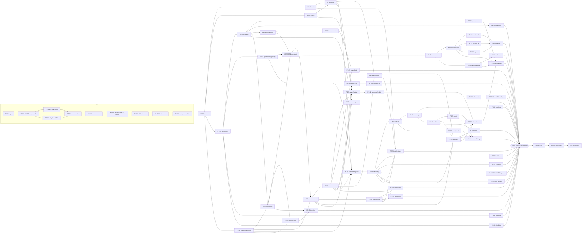

# Roadmap — Tassyir-style COD commerce SaaS on Vendure

**Objective:** a functional clone of Tassyir (multi-store, cash-on-delivery e-commerce SaaS for Algeria) with our own name and branding.
**Base:** a clean private repository whose workspace consumes the **published `@vendure/*` packages pinned to one exact version** (ADR 0001; Vendure source is read from a reference clone outside the repo) — TypeScript · NestJS · GraphQL · React dashboard. **Vendure core is never modified**; every feature lives in a plugin; an emergency fix is only possible as a reviewed `pnpm patch` (ADR 0001). Merchant screens: Vendure React dashboard extensions (ADR 0010, subject to spike A). Storefront + builder runtime: our own Next.js 16 app, multi-tenant by host (ADR 0006). Postgres 17, Valkey, Cloudflare; hosting per ADR 0011: **in Algeria** on self-run VPSs (single-VPS compose minimum, backups at a second Algerian provider, no managed services or Kubernetes), platform domain `.com.dz`. Architecture: [../architecture/README.md](../architecture/README.md).
**Architecture reference (binding for every session):** [../architecture/README.md](../architecture/README.md) with `system-design.md`, `infrastructure.md`, `tech-stack.md`, and the ADRs in [../adr/](../adr/) (drafts in `../adr/drafts/` until P0.S2a accepts them). Every brief's "Read first" names the sections it relies on.
**Rules for every session:** [CONTRIBUTING.md](CONTRIBUTING.md). **Brief format:** [_session-template.md](_session-template.md). **Handoff notes:** `handoff/P{n}.S{m}.md`.
**Source of truth:** [../feature-inventory.md](../feature-inventory.md) and [../research/](../research/) — sessions never re-research Tassyir.

## How to use this roadmap
1. Pick the next session whose prerequisites are merged (see the table and graph). Sessions marked parallel-safe can run at the same time in separate worktrees/sessions.
2. Open a fresh Claude session in the repo, paste the session's **kickoff prompt** from its phase file.
3. The session first lists the open `audit` issues it owns (its brief has an **Audit issues to close** block; rule in CONTRIBUTING.md) and plans them with its own work.
4. The session ends with a PR and a handoff note and stops. You review and merge (squash). Then start the next one.

## Phases

| Phase | Goal | Exit criteria | Sessions |
|---|---|---|---|
| [P0 Setup](P0-setup.md) | Repo, GitHub, CI, dev env and the architecture decisions everything else builds on | Repo builds; CI green on a PR; ADRs merged; `apps/server` + `apps/storefront` + plugin template run locally; all issues/milestones exist | 3 |
| [P1 Foundation](P1-foundation.md) | Multi-tenant Business→Stores, accounts, permissions, team, Arabic RTL admin shell, platform plumbing (outbox, webhook gateway, queues, secrets, flags) | Two businesses on one deployment cannot see each other's data; a member with a custom role sees only what the role allows; admin works in AR/RTL; outbox and webhook gateway survive a crash and a Valkey flush | 6 |
| [P2 Catalog & offers](P2-catalog-offers.md) | Products, variants, packs, collections, the 7-kind offer engine | Products with variants/packs managed in admin; every offer kind priced correctly by the pricing service in unit tests | 5 |
| [P3 Storefront & COD checkout](P3-storefront-checkout.md) | Public store per subdomain with the COD form, live quotes, order intake; staging environment | A buyer on `.localhost` orders a product with wilaya/commune/home-desk; the order appears as pending with the signed quote total; abandoned checkouts captured; staging deploys on merge to `main` | 5 |
| [P4 Order operations](P4-order-ops.md) | Call-centre workflow: statuses, actions, lists, detail, assignment, spam, customers | Full confirm/cancel/schedule/custom-status loop works with timeline; orders auto-assigned; spam holds and rules work; customers can be banned | 7 |
| [P5 Delivery](P5-delivery.md) | Carrier adapters, dispatch, tracking, returns, exchanges | Private courier loop dispatch→deliver→return works end to end; each real carrier adapter passes its contract tests against a mock | 7 |
| [P6 Inventory & finance](P6-inventory-finance.md) | Stock movements, locations, wallets ledger, carrier cash, P&L, costs, simulator | Dispatch/return move stock; collections post to wallets; P&L for a range matches a hand-computed fixture | 5 |
| [P7 Analytics & home](P7-analytics-home.md) | Reports, home dashboard, notifications | Home KPIs and Needs-you match seeded data; reports export; notifications fire per order event | 3 |
| [P8 Builder & themes](P8-builder-themes.md) | Section-based store builder, styles, themes, landing pages, A/B tests, domains | Merchant edits and publishes a store and a landing page; theme switch works; custom domain verified (staging) | 9 |
| [P9 SaaS & integrations](P9-saas-integrations.md) | Plans/quotas/payments/credits, pixels/CAPI, ads, Sheets, WhatsApp, platform sync, AI, public API/MCP, sourcing | Trial→plan upgrade in sandbox; quota masking works; pixel test events reach sandbox; AI assistant answers with credits deducted | 11 |
| [P10 Hardening & launch](P10-hardening.md) | E2E suite, security and performance, deployment | E2E COD loop green in CI; tenant-isolation and authz tests pass; production deploy with wildcard subdomains + TLS | 3 |
| Maintenance | Bump the pinned `@vendure/*` version (migrations, patches, changelog review) | Runs whenever a Vendure minor is released | M.S1 (repeatable) |

**Total: 66 sessions + repeatable upstream sync.**

## Session list

Model: **O** = Opus (architecture, tricky logic), **S** = Sonnet (well-specified build). Size: S ≈ 1–2 h, M ≈ 2–3 h, L ≈ 3–4 h of agent work. 🔑 = needs external credentials (runs against a mock until provided).

| ID | Title | Branch | Depends on | Parallel-safe with | Model | Size | 🔑 |
|---|---|---|---|---|---|---|---|
| P0.S1 | Repo, GitHub & CI setup | `chore/p0-s1-repo-setup` | — | — | S | M | gh auth (you) |
| P0.S2a-1 | ADRs 0001–0010 & spikes A/B | `docs/p0-s2a-adrs` | P0.S1 | — | O | L | |
| P0.S2a-2 | Scale spikes C/D (ADRs 0002, 0013, 0016) | `docs/p0-s2a2-scale-spikes` | P0.S2a-1 | P0.S2a-3 | O | L | |
| P0.S2a-3 | Search, cache & latency spikes E/F/G | `docs/p0-s2a3-search-cache-spikes` | P0.S2a-1 | P0.S2a-2 | O | L | (spike F/G: Cloudflare staging zone, latency probes; pending until provided) |
| P0.S2b-1 | Foundation: workspace, quality gates, data services, CI | `feat/p0-s2b-scaffolding` | P0.S2a-1, P0.S2a-2, P0.S2a-3 | — | O | L | |
| P0.S2b-2 | Server core: env, config, health probes | `feat/p0-s2b2-server-core` | P0.S2b-1 | — | O | L | |
| P0.S2b-3 | Server data & image: migrate, seed, e2e, Dockerfile, roles | `feat/p0-s2b3-server-data-image` | P0.S2b-2 | — | O | L | |
| P0.S2b-4 | Dashboard RTL: merchant-shell dashboard host | `feat/p0-s2b4-dashboard` | P0.S2b-3 | — | O | L | |
| P0.S2b-5 | Storefront: host-resolved storefront and shared cache | `feat/p0-s2b5-storefront` | P0.S2b-4 | — | O | L | |
| P0.S2b-6 | Plugin template: reference implementation of the principles | `feat/p0-s2b6-plugin-template` | P0.S2b-5 | — | O | M | |
| P1.S1 | Business→Stores tenancy | `feat/p1-s1-tenancy` | P0.S2b-6 | — | O | L | |
| P1.S2 | Accounts & auth | `feat/p1-s2-auth` | P1.S1 | P1.S3, P1.S5, P1.S6 | S | M | 🔑 Google/Facebook OAuth (mock) |
| P1.S3 | Permissions catalog & roles | `feat/p1-s3-rbac` | P1.S1 | P1.S2, P1.S5, P1.S6 | O | L | |
| P1.S4 | Team members & invitations | `feat/p1-s4-team` | P1.S2, P1.S3 | P1.S5, P1.S6 | S | M | SMTP (Mailpit locally) |
| P1.S5 | Admin shell, navigation & Arabic RTL | `feat/p1-s5-admin-shell` | P1.S1 | P1.S2, P1.S3, P1.S4, P1.S6 | S | M | |
| P1.S6 | Platform plumbing: outbox, webhook gateway, queues, secrets, flags | `feat/p1-s6-platform-plumbing` | P1.S1 | P1.S2, P1.S3, P1.S4, P1.S5, P2.S1, P3.S1 | O | L | |
| P2.S1 | Products & variants | `feat/p2-s1-products` | P1.S5 | P3.S1, P1.S6 | S | L | |
| P2.S2 | Packs, import & export | `feat/p2-s2-packs-import` | P2.S1 | P2.S3, P2.S4, P3.S5 | S | M | |
| P2.S3 | Collections with conditions | `feat/p2-s3-collections` | P2.S1 | P2.S2, P2.S4, P3.S5 | S | S | |
| P2.S4 | Pricing & offer engine core | `feat/p2-s4-offer-engine` | P2.S1 | P2.S2, P2.S3, P3.S5 | O | L | |
| P2.S5 | Offer kinds BXGY/add-on & offers admin | `feat/p2-s5-offers-admin` | P2.S4 | P2.S2, P2.S3, P3.S2, P3.S5 | S | L | |
| P3.S1 | Wilaya/commune data & delivery pricing | `feat/p3-s1-geo-delivery-pricing` | P1.S5 | P2.*, P3.S2, P1.S6 | S | M | |
| P3.S2 | Multi-tenant storefront skeleton | `feat/p3-s2-storefront-skeleton` | P2.S1, P1.S6 | P2.S4, P2.S5, P3.S1 | O | L | |
| P3.S3 | Product page, COD form, cart & checkout | `feat/p3-s3-cod-checkout` | P3.S1, P3.S2, P2.S4 | P2.S5, P3.S5 | S | L | |
| P3.S4 | Order intake & abandoned checkouts | `feat/p3-s4-order-intake` | P3.S3, P1.S6 | P3.S5 | O | L | 🔑 Turnstile keys (Cloudflare test keys) |
| P3.S5 | Staging environment, IaC & observability baseline | `chore/p3-s5-staging` | P3.S2, P1.S6 | P2.*, P3.S3, P3.S4 | O | L | 🔑 Algerian VPS trials + chosen provider, second provider for backups, Cloudflare account, staging zone |
| P4.S1 | Order state machine & actions | `feat/p4-s1-order-states` | P3.S4 | P4.S5 | O | L | |
| P4.S2 | Orders list, filters, bulk & export | `feat/p4-s2-orders-list` | P4.S1 | P4.S3, P4.S4, P4.S5, P4.S7 | S | L | |
| P4.S3 | Order detail, create/edit & agent upsell | `feat/p4-s3-order-detail` | P4.S1, P2.S5 | P4.S2, P4.S4, P4.S5, P4.S7 | S | L | |
| P4.S4 | Assignment & order distribution | `feat/p4-s4-distribution` | P4.S1, P1.S4 | P4.S2, P4.S3, P4.S5, P4.S7 | O | M | |
| P4.S5 | Spam engine & held orders | `feat/p4-s5-spam-engine` | P3.S4 | P4.S1–S4 | O | L | |
| P4.S6 | Spam rule builder | `feat/p4-s6-spam-rules` | P4.S5 | P4.S2–S4, P4.S7 | S | M | |
| P4.S7 | Customers & bans | `feat/p4-s7-customers` | P4.S1, P4.S5 | P4.S2–S4, P4.S6 | S | M | |
| P5.S1 | Carrier adapter interface, Private Courier & dispatch | `feat/p5-s1-carrier-dispatch` | P4.S1, P3.S1, P1.S4, P1.S6 | — | O | L | |
| P5.S2 | Tracking, parcel drawer & labels | `feat/p5-s2-tracking` | P5.S1 | — | S | L | |
| P5.S3 | Returns & exchanges | `feat/p5-s3-returns` | P5.S2 | P5.S4–S7 | S | M | |
| P5.S4 | Yalidine-family adapter | `feat/p5-s4-yalidine` | P5.S2 | P5.S3, P5.S5–S7 | S | M | 🔑 Yalidine API ID/token |
| P5.S5 | Ecotrack-family adapter | `feat/p5-s5-ecotrack` | P5.S2 | P5.S3, P5.S4, P5.S6, P5.S7 | S | M | 🔑 Ecotrack token |
| P5.S6 | Carriers: ZR Express, NOEST, Maystro | `feat/p5-s6-carriers-a` | P5.S2 | P5.S3–S5, P5.S7 | S | L | 🔑 per carrier |
| P5.S7 | Carriers: Elogistia, Ecom Delivery, Zimou, Osen | `feat/p5-s7-carriers-b` | P5.S2 | P5.S3–S6 | S | L | 🔑 per carrier |
| P6.S1 | Inventory core & auto movements | `feat/p6-s1-inventory` | P5.S3 | P5.S4–S7 | S | L | |
| P6.S2 | Locations, transfers & packaging | `feat/p6-s2-locations-packaging` | P6.S1 | P6.S3, P6.S5 | S | M | |
| P6.S3 | Wallets ledger & carrier collections | `feat/p6-s3-wallets` | P6.S1 | P6.S2, P6.S5 | O | L | |
| P6.S4 | Profit report, costs & ad spend | `feat/p6-s4-profit-costs` | P6.S3 | P6.S2, P6.S5 | O | L | |
| P6.S5 | Product study simulator | `feat/p6-s5-simulator` | P1.S5 | any | S | S | |
| P7.S1 | Analytics overview & reports | `feat/p7-s1-analytics` | P5.S2, P4.S4, P3.S4, P6.S3 | P7.S3, P6.S4, P8.* | S | L | |
| P7.S2 | Home dashboard & onboarding | `feat/p7-s2-home` | P7.S1, P6.S3, P6.S4 | P7.S3, P8.* | S | M | |
| P7.S3 | Notifications centre & preferences | `feat/p7-s3-notifications` | P1.S2, P4.S4, P4.S5, P5.S2 | P7.S1, P7.S2, P8.* | S | M | Web Push VAPID keys (generate) |
| P8.S1 | Theme & section model + renderer | `feat/p8-s1-theme-model` | P3.S3 | P6.*, P7.* | O | L | |
| P8.S2 | Builder editor shell | `feat/p8-s2-builder-shell` | P8.S1 | P8.S7, P8.S9 | S | L | |
| P8.S3 | Sections library A (layout & content) | `feat/p8-s3-sections-a` | P8.S2 | P8.S4, P8.S5, P8.S7, P8.S9 | S | L | |
| P8.S4 | Sections library B (product page & conversion) | `feat/p8-s4-sections-b` | P8.S2 | P8.S3, P8.S5, P8.S7, P8.S9 | S | L | |
| P8.S5 | Styles & design tokens | `feat/p8-s5-styles` | P8.S2 | P8.S3, P8.S4, P8.S7, P8.S9 | S | L | |
| P8.S6 | Themes: presets, apply, history | `feat/p8-s6-themes` | P8.S3, P8.S4, P8.S5 | P8.S7–S9 | S | M | |
| P8.S7 | Landing pages & block editor | `feat/p8-s7-landing-pages` | P8.S1 | P8.S2–S6, P8.S9 | S | L | |
| P8.S8 | A/B tests | `feat/p8-s8-ab-tests` | P8.S7 | P8.S6, P8.S9 | S | M | |
| P8.S9 | Subdomains & custom domains | `feat/p8-s9-domains` | P3.S2, P3.S5 | P8.* | O | M | 🔑 Cloudflare API token (custom hostnames) on the P3.S5 staging zone |
| P9.S1 | Plans, trial, quotas & feature gates | `feat/p9-s1-plans-quotas` | P1.S4, P3.S4 | P9.S3, P9.S5, P9.S6, P9.S8a, P9.S8b, P9.S9 | O | L | |
| P9.S2 | Payments (Chargily/SlickPay/Stripe) & AI credits | `feat/p9-s2-payments-credits` | P9.S1 | P9.S3–S6, P9.S8a, P9.S8b, P9.S9 | S | L | 🔑 sandbox keys |
| P9.S3 | Pixels, CAPI & catalog feed | `feat/p9-s3-pixels-capi` | P5.S3 | P9.S1, P9.S2, P9.S5, P9.S6, P9.S7a, P9.S8a, P9.S8b, P9.S9 | S | M | 🔑 test pixels/tokens |
| P9.S4 | Ad accounts & marketing analytics | `feat/p9-s4-ads-marketing` | P9.S3, P7.S1, P6.S4 | P9.S5, P9.S6, P9.S7a, P9.S8a, P9.S8b, P9.S9 | S | L | 🔑 Meta/TikTok apps |
| P9.S5 | Google Sheets & WhatsApp | `feat/p9-s5-sheets-whatsapp` | P4.S2 | all other P9 | S | M | 🔑 Google OAuth, WhatsApp |
| P9.S6 | Store-platform sync (Shopify, YouCan, WooCommerce, Ayor, Order Dz) | `feat/p9-s6-platform-sync` | P4.S1, P2.S1 | all other P9 | S | L | 🔑 per platform |
| P9.S7a | AI assistant, tools & credit metering | `feat/p9-s7a-ai-assistant` | P9.S2, P7.S1 | P9.S3–S6, P9.S8a, P9.S8b, P9.S9 | O | L | 🔑 Anthropic API key |
| P9.S7b | AI builder, landing-page & product features | `feat/p9-s7b-ai-features` | P9.S7a, P8.S2, P8.S7, P2.S2 | P9.S8a, P9.S8b, P9.S9 | S | M | 🔑 Anthropic API key; image clean-up provider |
| P9.S8a | Public API & signed webhooks | `feat/p9-s8a-public-api` | P4.S1, P1.S3 | all other P9 except P9.S8b | O | M | |
| P9.S8b | App platform & MCP server | `feat/p9-s8b-apps-mcp` | P9.S8a | all other P9 except P9.S8a | O | L | |
| P9.S9 | Sourcing requests | `feat/p9-s9-sourcing` | P1.S5 | any | S | S | |
| P10.S1 | End-to-end test suite | `test/p10-s1-e2e` | every P1–P9 session (the leaves: P2.S3, P4.S3, P4.S6, P4.S7, P5.S4–S7, P6.S2, P6.S5, P7.S2, P7.S3, P8.S6, P8.S8, P8.S9, P9.S4–S6, P9.S7b, P9.S8b, P9.S9) | — | S | L | |
| P10.S2 | Security & performance hardening | `fix/p10-s2-hardening` | P10.S1 | — | O | L | |
| P10.S3 | Production deployment | `chore/p10-s3-deploy` | P10.S2 | — | O | M | 🔑 production Algerian VPS(s), `.com.dz` domain on Cloudflare, Cloudflare for SaaS; spike G and legal checklist answered |
| M.S1 | Upstream Vendure sync (repeatable) | `chore/upstream-sync-<version>` | P0.S2b-6 | — | S | S | |

GitHub issue title = `P{n}.S{m} <Title>` (e.g. `P1.S1 Business→Stores tenancy`), label `phase-{n}`, milestone `P{n} <phase name>`.

## Dependency graph

**Critical path (core COD loop, 17 sessions):** P0.S1 → P0.S2a-1 → P0.S2a-2 → P0.S2b-1 → P0.S2b-2 → P0.S2b-3 → P0.S2b-4 → P0.S2b-5 → P0.S2b-6 → P1.S1 → P1.S5 → P2.S1 → P2.S4 → P3.S3 → P3.S4 → P4.S1 → P5.S1 → P5.S2 → P5.S3 → P6.S1 → P6.S3 → P6.S4 (profit). The launch path then runs P6.S3 → P7.S1 → P9.S7a → P9.S7b → P10.S1 → P10.S2 → P10.S3 (the AI lane is the longest tail; start P9.S1/P9.S2 early). The two infrastructure sessions are off the critical path but gate it: **P1.S6** (platform plumbing) must merge before P3.S2, P3.S4 and P5.S1 — start it right after P1.S1, in parallel with P1.S2–S5 (P1.S1 → P1.S6 is one L session against P1.S5 → P2.S1 on the critical path, so it has about one session of slack); **P3.S5** (staging) must merge before P8.S9 and, through P10.S1, before P10.S3 — start it right after P3.S2. P0.S2a (now L, then split into three L sessions because its plan measured ≈ 13.7 h; P0.S2a-3 runs in parallel with P0.S2a-2) and P3.S4 (now L) lengthen the critical path by about 5.5 h. After P3.S4 the work fans out widely (P4, P5 carriers, P8 builder, P9 integrations all run in parallel lanes). P10 starts only when every P1–P9 session is merged.

**Parallel-safe rule:** two sessions may run at once only if each owns separate plugin folders/app routes listed in its brief and neither modifies a shared file (root `vendure-config.ts`, shared types package) beyond appending its own registration line. Merge conflicts on those registration lines are expected and trivial; resolve by keeping both lines.

## Estimate
- 66 sessions = 3 S + 23 M + 40 L ≈ **202 hours of agent work** at S 1.5 h, M 2.5 h, L 3.5 h (range **≈ 169–235 h** with S 1–2 h, M 2–3 h, L 3–4 h; M.S1 extra, ~1 h each time). Changes since the 62-session plan: P0.S2a M → L (spikes C–G), then split into P0.S2a-1/-2/-3 (L each; its executable plan measured ≈ 13.7 h, see `plans/P0.S2a-plan.md`), P3.S4 M → L (Turnstile, read model, outbox, intake spool), new P1.S6 (L) and P3.S5 (L).
- At 2–3 sessions per day (5-hour usage windows, plus your reviews) and running parallel lanes after P1.S1 and P3: **about 7–10 weeks calendar** (P1.S6 and P3.S5 run in parallel lanes). The core COD loop (through P6.S4) is 17 serial sessions (3 M + 14 L ≈ 57 h) ≈ **3–4 weeks**.

## Shared contracts (who owns what across sessions)
These are the cross-session seams; the owning session defines them, later sessions only consume or register.
| Contract | Owner | Consumers |
|---|---|---|
| Snowflake id generator (`SnowflakeGenerator`, `toSnowflake`) and tenancy contracts (`TenantContext`, `classifySubdomain`, `formatOrderNumber`, host helpers) in `packages/shared` | P1.S1 | every session that creates a row of ours, the storefront |
| Per-business order number sequence service | P1.S1 | P3.S4 assigns at acceptance; P4.S5 assigns on spam release |
| `requireFeature()` / limit checks (no-op until P9.S1) | P0.S2b (stub) → P9.S1 (real) | Every gated session calls it when it builds the feature (finance, tracked items, team seats, landing pages per product, active offers). P9.S1 wires gates for sessions already merged; later sessions call it themselves |
| Repo layout, dashboard code path (`plugins/<name>/dashboard/` or the ADR 0010 mapping), order lifecycle and quote→order-total strategy | P0.S2a-1 (ADR 0001, 0010, 0009, 0004) | every session; P3.S4 (pending state, totals), P4.S1 (full process) |
| Pricing/quote engine + HMAC quote token (`PricingService.quote()`, `verifyQuote()`) | P2.S4 | P3.S3 endpoints, P3.S4 verify, P4.S3 upsell/reprice, P8.S7 order-form block |
| `UnitPriceResolver` port (default: variant price) | P2.S4 | P2.S2 registers the pack resolver; whichever of the two merges second wires the registration line |
| Shipping-quote function | P3.S1 | P2.S4 (injected), P3.S3 |
| Delivery-pricing overrides stored separately from carrier defaults | P3.S1 | P5.S4–S7 price sync must never overwrite overrides |
| `SpamGate` port (default pass-through) | P3.S4 | P4.S5 registers the evaluator; P4.S6 extends it |
| Order confirm-time hook: `PreConfirmCheck` registry (warn/block results shown in the confirm dialog) | P4.S1 | P6.S1 stock warning |
| `isSpam` flag + mark-spam hook; trust-device action emits `DeviceTrusted` | P4.S1 | P4.S5 spam engine (persists `TrustedDevice`) |
| Block list (phones/devices), `SpamBlock` entity, `/orders/ban` + `/orders/unban` endpoints | **P4.S5** | P4.S7 customer block dialog + cancel-unshipped, P4.S3 ban button (feature-flagged until P4.S5 and P4.S7 are merged) |
| `StockAvailability` port (default "ok") | P5.S1 | P6.S1 registers the real provider (one registration line in carriers config) |
| Parcel status model; manual Update Status UI + `ParcelStatusChanged`/`OrderDelivered`/`OrderReturned` | P5.S1 (model) / P5.S2 (UI + events) | P6, P7, P9.S3 |
| `ReturnProcessed` (restock/damaged/missing qty) | P5.S3 | P6.S1 stock buckets |
| Return fee posting | P6.S3 on `OrderReturned` | P6.S4 P&L |
| Section registry (folder per section, build-time glob) | P8.S1 | P8.S3, P8.S4 add folders only |
| AI extension points as hidden stubs: `builder.ai.tab` + `builder.ai.askForChanges` (P8.S2), `builder.ai.pageCode` (P8.S5), `landingPages.ai.*` (P8.S7), product polish + image clean-up hooks (P2.S2), `analytics.aiQuestions` (P7.S1) | P8.S2 / P8.S5 / P8.S7 / P2.S2 / P7.S1 | P9.S7a (analytics, assistant), P9.S7b (builder, landing, product) |
| `LlmClient` + `withCredits(action)` metering | P9.S7a | P9.S7b, P9.S8b (MCP does not spend credits) |
| API key scopes + webhook signing | P9.S8a | P9.S8b (MCP and apps reuse the scopes) |
| Domain event names (`packages/shared/src/events/`, written `packages/shared/events` in briefs); every domain event is written through the outbox in the emitting transaction | first emitting session | all subscribers |
| Host map: in-process LRU (60 s) + Valkey `host:{APP_ENV}:{host}` + pub/sub invalidation on `host-invalidate:{APP_ENV}` (D309), `GET /store/resolve` | P1.S1 | P3.S2 (`proxy.ts`), P8.S9 (custom domains) |
| `OutboxService.add(ctx, topic, payload)` (same-transaction), relay + sweeper, consumer job-id convention `{outboxId}:{consumer}` | P1.S6 | P3.S4, P4.S1, P5.*, P7.S3, P9.S3, P9.S8a, P9.S5, P9.S6 |
| `job-reconciler` (re-enqueues non-terminal durable rows: outbox deliveries, inbound webhooks, …, after a Valkey loss) + `scheduler_task_last_success_age_seconds` | P1.S6 | every session that adds a durable job row registers its table with the reconciler (e.g. P5.S1 dispatch, P9.* integrations) |
| Inbound webhook gateway `POST /webhooks/{provider}/{accountKey}` + `InboundWebhookHandler` registry (dedupe, enqueue) | P1.S6 | P5.S4–S7, P9.S2, P9.S5, P9.S6 |
| `InternalOnlyGuard` + internal HMAC (method, path, timestamp, store/IP/country headers, body hash) for `/shop-api`, `/store/*`, `/_internal/*`; signed storefront internal client | P1.S6 | P1.S1 resolver call, P3.S2 (`/api/store/*` handlers, `/_internal/revalidate`), P3.S3, P3.S4, P8.* publish/revalidate |
| Queue names + pools (`packages/shared/src/queues.ts`), per-business semaphore helper, circuit-breaker helper | P1.S6 | every session that adds jobs |
| `TenantSecretService` (envelope encryption, write-only fields) | P1.S6 | P5.S1 carrier credentials, P9.S2–S6 tokens |
| `flags.isEnabled(ctx, key)` operational flags/kill switches | P1.S6 | P3.S4 (`intake.spool.enabled`), P5.*, P9.* |
| Partition helper + `partition-maintenance` task | P1.S6 | P4.S1 (`order_event`), P5.S2 (`parcel_event`), P6.S1 (`stock_movement`), P3.S4 (`visitor_event`), P9.S3/S8a (delivery logs) |
| Storefront cache contract: `'use cache'` tags (`store:`, `product:`, `theme:`, `offers:`), shared Redis cache handler, `POST /_internal/revalidate`, same-origin `/api/store/*` | P3.S2 | P3.S3, P8.* (publish → revalidate), P8.S8 (`no-store` for tested pages), P8.S9 (purge by hostname) |
| COD read model `cod_order` / `cod_order_item` / `order_counter` (same-transaction projection) | P3.S4 (create) → P4.S1 (transitions) → P4.S2 (indexes) | P4.*, P5.*, P7.S1, P9.S5 |
| Intake spool (degraded mode): Valkey stream `{env}:intake:spool`, `202` answer, `intake-spool-replay` task, `intake_spool_length` metric | P3.S4 | P3.S5 (chaos check, alert), P10.S3 (alert), M.S1 (maintenance window) |
| Shared `applyParcelEvent` (dedupe, ordering, read-model update, outbox) | P5.S2 | P5.S4–S7 (webhooks and polling) |
| `/readyz` + `/livez` (api, worker, storefront); probes never use Vendure's `/health` (ADR 0015) | P0.S2b | P3.S5, P10.S3 |
| Compose stack that runs unchanged on one VPS; `DATABASE_URL` (PgBouncer) + `DATABASE_URL_DIRECT`; `migrate` before api/worker; `TZ=UTC` (ADR 0011, 0013, 0016) | P0.S2b | P3.S5, P10.S3, every session's tests |
| Deploy pipeline, `ROLE` image, Kamal config, server runbook/Ansible, OpenTofu modules (Cloudflare/DNS only, ADR 0011) | P3.S5 | P8.S9, P10.S3, M.S1 |

## Rows split across sessions
When a coverage row lists several sessions, each brief states which part it does. **Tick the checkbox only in the session that completes the last remaining part of the row** — for parallel sessions sharing a row (e.g. P5.S4–S7), whichever merges last, after checking the others' handoffs; the other sessions note their part in the handoff and the PR body.
- Re-check plan usage after P1 and adjust the model mix (more Sonnet if usage runs high).

## Blocked on external credentials (build against mocks first)
| Session | What you need to provide | Mock used until then |
|---|---|---|
| P0.S1 | `gh auth login --scopes workflow` (you run it); GitHub Pro (or Team) if you want real branch protection on a private repo | Free plan: pre-push hook + "never push to main" rule (P0.S1 step 7) |
| P0.S2a-3 | Cloudflare staging zone (spike F edge items); latency probes from Algerian networks (spike G) | Items recorded as "pending" in ADR 0006/0011; re-run in P3.S5 (F) and before P10.S3 (G) |
| P1.S2 | Google & Facebook OAuth apps | Mocked OAuth provider in tests; buttons hidden behind a flag |
| P1.S4, P7.S3 | SMTP for real email | Mailpit in docker-compose |
| P3.S4 | Cloudflare Turnstile site/secret key | Cloudflare's published Turnstile test keys (always-pass / always-fail) |
| P3.S5 | Trial VPSs at the shortlisted Algerian providers, an account at the chosen one and at a second Algerian provider (backups), Cloudflare account with the `.com.dz` domain (staging zone), GitHub environment secrets (ADR 0011) | — (session stops at a "needs you" checklist) |
| P5.S4–S7 | Carrier API credentials (Yalidine, Ecotrack, ZR, NOEST, Maystro, Elogistia, Ecom Delivery, Zimou, Osen) | Contract-test mock servers per carrier (recorded request/response fixtures) |
| P8.S9 | The P3.S5 staging environment and a Cloudflare API token scoped to custom hostnames on the staging zone | `*.localhost` + manual DNS verification stub + mocked Cloudflare client |
| P9.S2 | Chargily, SlickPay, Stripe sandbox keys | Fake payment provider that auto-confirms |
| P9.S3, P9.S4 | Test pixels, CAPI tokens, Meta/TikTok developer apps | Event recorder endpoint; fixture spend data |
| P9.S5 | Google Cloud OAuth app; WhatsApp Business/Cloud API | In-memory sheet adapter; console WhatsApp adapter |
| P9.S6 | Shopify partner app, YouCan/Woo/Ayor/Order Dz accounts | Fixture webhooks |
| P9.S7a, P9.S7b | Anthropic API key (Claude); for P9.S7b also an image background-removal provider (an LLM cannot edit images) | Stubbed LLM responses in tests; image clean-up returns the input image |
| P10.S2 | Approval to scale staging for the load-test window (if a Growth-spike target needs it) | Load test on staging as provisioned; size recorded with the results |
| P10.S3 | Production VPS(s) at the Algerian provider chosen in P3.S5 and backup storage at the second provider, the `.com.dz` platform domain on Cloudflare, Cloudflare for SaaS enabled, GitHub environment secrets; spike G probes; answers to the pre-production legal checklist (ANPDP, ARPCE, Law 18-05; ADR 0011) | — (session stops at a "needs you" checklist) |

## Coverage table (inventory row → session)
Rows refer to [../feature-inventory.md](../feature-inventory.md). Inventory text mentions "Tassyir"/"Tassya" because it describes the reference product; our product uses its own names (ADR 0007), e.g. the default delivery table is seeded as "Platform default prices". Section numbers match the inventory; "X" = the "Added from the second pass" table. Out of scope for v1: section 15 (mobile app, Chrome extension) and Tassyir staff back-office.

### 1. Accounts, business, billing
| Row | Session |
|---|---|
| Register/login/logout/verification/reset/change password/email | P1.S2 |
| Google and Facebook sign-in | P1.S2 |
| Business profile and onboarding state | P1.S1 |
| Multi-store per business, store switcher | P1.S1 (API) + P1.S5 (UI) |
| Plans Starter/Basic/Advanced + prepay discounts | P9.S1 |
| Plan quotas | P9.S1 (incl. landing pages per product limit; AI credits per cycle → P9.S2) |
| Over-quota / expired-trial phone masking | P9.S1 |
| 7-day trial | P9.S1 |
| Change plan, renew early, cancel renewal, payment history | P9.S2 |
| Checkout Edahabia/CIB + Stripe portal | P9.S2 |
| AI credits balance, packs, history | P9.S2 |
| Locale switch EN/AR with RTL | P1.S5 |
| Notifications centre | P7.S3 |
| Activity log | P1.S3 |

### 2. Home dashboard
| Row | Session |
|---|---|
| Today KPIs | P7.S2 |
| Needs-you queue | P7.S2 |
| Money on the way | P7.S2 |
| Today on the map | P7.S2 |
| Last 7 days summary | P7.S2 |
| Next steps nudges | P7.S2 |

### 3. Orders and confirmation
| Row | Session |
|---|---|
| Orders list tabs, search, pagination | P4.S2 |
| Filters | P4.S2 |
| Statuses incl. custom + sub-statuses | P4.S1 |
| Row actions | P4.S2 |
| Bulk actions | P4.S2 |
| Export dialog + templates | P4.S2 |
| Create order manually | P4.S3 |
| Order detail | P4.S3 |
| Timeline with time in stage | P4.S1 (data) + P4.S3 (UI) |
| Internal comments | P4.S1 (API) + P4.S3 (UI) |
| Buyer record on order, ban | P4.S3 |
| Assignment panel & history | P4.S4 |
| Parcel opening allowed/not | P5.S1 |
| Order source attribution | P3.S4 (capture) + P4.S3 (display) |
| More actions | P4.S1 (actions) + P4.S3 (menu); exchange → P5.S3 |
| Cancel reasons | P4.S1 |
| Custom order fields | P4.S3 |
| Duplicate detection and merge | P4.S5 |
| Abandoned checkouts | P3.S4 |
| Stock warning when confirming | P6.S1 |
| WhatsApp order confirmation | P9.S5 |
| Ask Tassya about your orders (AI) | P9.S7a |

### 4. Customers and spam
| Row | Session |
|---|---|
| Customers list | P4.S7 |
| Customer detail page | P4.S7 |
| Ban/unban by phone or device | P4.S5 (block list + endpoints) + P4.S7 (customer UI, cancel unshipped) |
| Held orders list | P4.S5 |
| Protection level | P4.S5 |
| Rule builder with templates | P4.S6 |
| Trusted devices, allow-list, blocked list | P4.S5 |
| Daily summary at 20:00 | P4.S5 |

### 5. Tracking, returns, exchanges
| Row | Session |
|---|---|
| Tracking list tabs | P5.S2 |
| Tracking filters | P5.S2 |
| Normalised + raw status, copy tracking | P5.S2 |
| Late-parcel detection | P5.S2 |
| Export deliveries | P5.S2 |
| Undispatch, validate, label status, print labels | P5.S2 |
| Returns list & processing | P5.S3 |
| Scan returns | P5.S3 |
| Exchanges as linked parcel | P5.S3 |
| Courier notes as notifications | P5.S2 (capture) + P7.S3 (notify) |

### 6. Delivery and shipping
| Row | Session |
|---|---|
| Carrier accounts list | P5.S1 |
| Carrier catalogue | P5.S1 (catalogue + Private) + P5.S4–S7 (adapters) |
| Multiple accounts, per-order carrier, store default | P5.S1 |
| Delivery pricing options | P3.S1 (+ carrier sync in P5.S4–S7) |
| Dispatch to carrier API | P5.S1 (flow) + P5.S4–S7 |
| Status sync (webhook/polling) | P5.S4–S7 |
| Carrier cash collection & payouts | P6.S3 |
| Wilaya & commune reference data | P3.S1 |

### 7. Products, catalog, offers
| Row | Session |
|---|---|
| Product list | P2.S1 |
| Product types incl. Pack | P2.S2 |
| Product form | P2.S1 |
| Product settings | P2.S1 |
| Bulk edit, export | P2.S2 |
| Import from link or spreadsheet | P2.S2 (AI polish → P9.S7b) |
| Collections | P2.S3 |
| Offers (7 kinds) | P2.S4 + P2.S5 |
| A/B tests | P8.S8 |
| Landing pages per product | P8.S7 |
| Sold-out behaviour | P1.S1 (settings fields) + P2.S1 (behaviour) + P3.S2 (storefront) |

### 8. Store, themes, builder, storefront
| Row | Session |
|---|---|
| Store profile settings | P1.S1 (data) + P3.S2 (applied on storefront) |
| Free subdomain | P1.S1 (field + availability check, used by sign-up) + P8.S9 (change subdomain, DNS/TLS) |
| Custom domains | P8.S9 |
| Themes | P8.S6 |
| Visual builder | P8.S2 |
| Sections | P8.S3 + P8.S4 |
| Styles | P8.S5 |
| AI design assistant | P9.S7b (in builder) + P9.S8b (via MCP) |
| Storefront pages | P3.S2 + P3.S3 |
| COD order form | P3.S3 |
| Abandoned checkout capture | P3.S4 |
| Visitor tracking & live beacon | P3.S4 |
| Pixels & CAPI | P9.S3 |
| Catalog feed URL | P9.S3 |

### 9. Inventory
| Row | Session |
|---|---|
| Stock per variant view | P6.S1 |
| Add/adjust/import/export stock | P6.S1 |
| Auto movements | P6.S1 |
| Movements history | P6.S1 |
| Packaging inventory | P6.S2 |
| Stock locations | P6.S2 |
| Buy-price history | P6.S1 |
| Plan gate 25 tracked items | P9.S1 |

### 10. Finance
| Row | Session |
|---|---|
| Profit report | P6.S4 |
| Missing-from-profit checklist | P6.S4 |
| Money in/out, money right now, outlook | P6.S3 (balances, outlook) + P6.S4 (money in/out chart) |
| Carrier cash | P6.S3 |
| Expenses | P6.S4 |
| Ad spend records | P6.S4 |
| Exchange rates | P6.S4 |
| Per-product profit | P6.S4 |
| Per-product by wilaya / by ad | P6.S4 |
| Link ad campaigns to products | P9.S4 |
| Wallets | P6.S3 |
| Product study simulator | P6.S5 |
| Plan gate full finance | P9.S1 |

### 11. Analytics
| Row | Session |
|---|---|
| Overview KPIs + compare | P7.S1 |
| Daily orders by stage | P7.S1 |
| Funnel & where orders are lost | P7.S1 |
| Reports products/wilayas/carriers/team | P7.S1 |
| Marketing tree | P9.S4 |
| AI questions | P9.S7a |
| Store visitors analytics | P7.S1 |

### 12. Team, roles, distribution
| Row | Session |
|---|---|
| Members list | P1.S4 |
| Invite with roles, store access, salary, commissions | P1.S4 |
| Member actions (limit, stop receiving, pay salary) | P1.S4 (pay = record salary expense, wired to P6.S4) |
| Roles: templates, custom, 94 permissions | P1.S3 |
| Order distribution | P4.S4 |
| Team stats report and commissions | P7.S1 (stats) + P1.S4 (commission configs) |

### 13. Apps and integrations
| Row | Session |
|---|---|
| AI assistants via MCP | P9.S8b |
| Meta Ads & TikTok Ads | P9.S4 |
| Store platforms Shopify/YouCan/Woo/Ayor | P9.S6 |
| Google Sheets | P9.S5 |
| Order Dz | P9.S6 |
| WhatsApp settings | P9.S5 |
| App platform | P9.S8b |
| Public Admin API, webhooks | P9.S8a (API + signed webhooks required; TS SDK, CLI, dev stores optional — follow-up if skipped) |

### 14. Sourcing
| Row | Session |
|---|---|
| Import from China requests | P9.S9 |

### X. Added from the second pass
| Row | Session |
|---|---|
| Sign-up wizard with subdomain check | P1.S2 |
| Onboarding checklist + Example data | P7.S2 |
| Account menu: profile, security, notification settings, language, theme | P1.S2 (profile/security) + P7.S3 (notification settings) + P1.S5 (language/theme) |
| Store switcher with Create Store | P1.S5 |
| Notification feed per order event | P7.S3 |
| Storefront pricing engine (cart-quote, nudge, quote token, shipping-quote) | P2.S4 (engine) + P3.S3 (endpoints) |
| Commune data with ONS codes | P3.S1 |
| Anti-bot signals on submit | P3.S4 |
| Spam engine | P4.S5 |
| Spam rule builder | P4.S6 |
| Agent upsell panel + audit diff | P4.S3 |
| Order states and actions | P4.S1 (dispatch → P5.S1) |
| Order numbering per business | P3.S4 |
| Parcel drawer | P5.S2 |
| Return processing dialog | P5.S3 |
| Exchanges limited to supporting carriers | P5.S3 |
| Carrier connect forms | P5.S1 (schema-driven forms) + P5.S4–S7 |
| Private courier tied to a member | P5.S1 |
| Default delivery-fee table; sync keeps overrides | P3.S1 |
| Customer detail page with block | P4.S7 |
| Cancel reasons seed, custom statuses, label statuses | P4.S1 (label statuses → P5.S2) |
| Inventory per variant, adjust reasons, transfers | P6.S1 (transfers → P6.S2) |
| Automatic wallet ledger, forecast | P6.S3 |
| Carrier collection expected vs received | P6.S3 |
| P&L "at most", working money | P6.S4 (working money → P6.S3) |
| Pack products, AI image clean-up, store-page template | P2.S2 (AI clean-up → P9.S7b; template → P8.S2) |
| Offer engine 7 kinds | P2.S4 + P2.S5 |
| Collections automatic conditions | P2.S3 |
| Landing pages | P8.S7 (AI generation → P9.S7b) |
| A/B test wizard | P8.S8 |
| Builder templates, sections, styles, shortcuts, AI tab | P8.S1–S5 (AI tab → P9.S7b) |
| Plans as data, providers, quota/grace, credit packs | P9.S1 + P9.S2 |
| Ask Tassya side panel | P9.S7a |
| Distribution reclaim/hops/exceptions/product managers | P4.S4 |
| Commission configs, role duplicate, permissions catalog, invitation resend/revoke | P1.S3 + P1.S4 |
| CAPI test events & test mode | P9.S3 |
| YouCan/Ayor/Shopify sync; media library | P9.S6 (media library → P2.S1) |
| Custom domain connect → DNS → verify | P8.S9 |
| Arabic dashboard RTL | P1.S5 |

## Audit issues without a feature session
Findings of `docs/audits/P1-audit.md` that no feature session owns. The gate, CI and evidence ones were filed under M.S1, which only bumps Vendure: a session that already touches `packages/config`, `.github/workflows` or `scripts/evidence` takes the ones in its path, and the rest wait for a maintenance session the user schedules. The others wait for a user decision.
- #123 SHELL-2 (medium): test(merchant-shell): derive stock routes from the route tree — owner in the audit: M.S1
- #128 PKG-9 (medium): fix(config): restrict eslint-disable and size-check JS files — owner in the audit: M.S1
- #129 PKG-10 (medium): refactor: remove or gate the `as unknown as` casts outside tests — owner in the audit: M.S1
- #131 CI-2 (medium): ci: alert when the browser workflow fails on main — owner in the audit: M.S1
- #132 EV-1 (medium): docs(evidence): mark the P0.S2b-6 evidence script as superseded — owner in the audit: M.S1
- #133 EV-2 (medium): docs(evidence): mark the P0.S2c-polish evidence script as superseded — owner in the audit: M.S1
- #137 ROADMAP-1 (medium): docs(roadmap): reassign the source changes handed to P3.S5 — owner in the audit: Roadmap PR docs/roadmap-audit-owners
- #140 M3 (medium): fix(config): bring scripts/ under the plugin entry-point gate — owner in the audit: M.S1
- #165 RBAC-9 (low): feat(rbac): add French labels for roles and permissions — owner in the audit: Copy pass session (user decision)
- #193 CI-4 (low): ci: tighten the commit attribution check — owner in the audit: M.S1
- #194 CI-5 (low): ci: let a re-run of the build-test gate job go green — owner in the audit: M.S1
- #195 CI-6 (low): ci: add dependabot.yml and CODEOWNERS — owner in the audit: M.S1
- #196 CI-7 (low): ci: run ci-duration.sh on a schedule — owner in the audit: M.S1
- #197 PKG-12 (low): fix(shared): guard the snowflake clock range — owner in the audit: M.S1
- #198 PKG-13 (low): test(testing): assert createTwoBusinesses returns two distinct businesses — owner in the audit: M.S1
- #199 PKG-14 (low): fix(shared): close the smaller i18n gate gaps — owner in the audit: M.S1
- #200 PKG-15 (low): chore(config): triage the remaining small gate gaps — owner in the audit: M.S1
- #201 GATE-1 (low): fix(config): make test:arch pass in a checkout under .claude/ — owner in the audit: M.S1
- #203 CO-2 (low): test(auth): run sign-in once against real Google and Facebook — owner in the audit: User, when credentials exist
- #204 CO-3 (low): feat(i18n): plan French copy and a native Arabic review — owner in the audit: User decision: a copy pass session

## Plan mutation protocol
- **Split** a session that won't fit: create `P{n}.S{m}a/b`, update this table, the graph and the issue.
- **Insert** a session: next free number in the phase, with a brief in the phase file.
- **Skip/abandon**: mark ~~strikethrough~~ here with the reason and move its inventory rows to another session.
- Every change to this file goes through a `docs/roadmap-<change>` PR.
